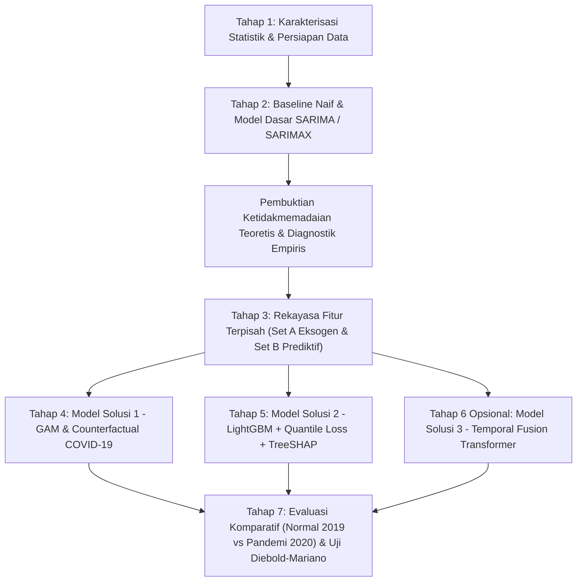

# Rencana Penelitian & Formulasi Matematis: Analisis Beban Listrik Per Jam Panama (2015–2020)

Dokumen ini merupakan rancangan lengkap (*end-to-end research plan*) untuk dataset [Panama_beban_listrik_per_jam_2015-2020_.xlsx](file:///c:/Users/user/Documents/S2/Semester%202/Analisis%20Data%20Lanjut/W12%20adl%201/Panama_beban_listrik_per_jam_2015-2020_.xlsx). Alur penelitian disusun secara deduktif: dimulai dari audit sifat stokastik data, pengujian model dasar **ARIMA/SARIMA (dan SARIMAX)**, pembuktian ketidakmemadaiannya baik secara **teoretis** maupun **diagnostik empiris**, lalu dilanjutkan dengan pemodelan solusi (**GAM + Counterfactual COVID-19**, **LightGBM + Quantile + TreeSHAP**, serta opsi lanjutan **Temporal Fusion Transformer / TFT**), dan ditutup dengan uji signifikansi perbandingan antar-model.

---

## Ringkasan Alur Penelitian

---

## Tahap 1: Karakterisasi Statistik Dataset & Persiapan Data

### 1.1 Spesifikasi Formal Data
Misalkan $Y_t \in \mathbb{R}^+$ menyatakan beban listrik nasional (`nat_demand`, satuan MWh) pada indeks waktu per jam $t = 1, 2, \dots, N$ dengan $N = 48.048$ observasi (`2015-01-03 01:00:00` hingga `2020-06-27 00:00:00` UTC−05:00, tanpa *missing values*). Vektor kovariat pada waktu $t$ didefinisikan sebagai:

$$\mathbf{X}_t = \left[ \mathbf{W}_t^{(\text{toc})},\; \mathbf{W}_t^{(\text{san})},\; \mathbf{W}_t^{(\text{dav})},\; \mathbf{C}_t \right]^\top$$

di mana:
- $\mathbf{W}_t^{(c)} = \left[ T2M_{t}^{(c)},\; QV2M_{t}^{(c)},\; TQL_{t}^{(c)},\; W2M_{t}^{(c)} \right]^\top$ adalah vektor meteorologi pada kota $c \in \{\text{toc}, \text{san}, \text{dav}\}$.
  - *Catatan skala variabel:* nilai `QV2M_*` berada pada rentang `0,0097–0,0227`, yang mencerminkan skala *specific humidity* (kg/kg) dari data NASA MERRA-2 meskipun metadata README menuliskannya dalam satuan `%`.
- $\mathbf{C}_t = \left[ \text{holiday}_t,\; \text{Holiday\_ID}_t,\; \text{school}_t \right]^\top$ adalah vektor atribut kalender, dengan $\text{Holiday\_ID}_t \in \{0, 1, \dots, 22\}$ (`23` kategori diskret).

Secara deskriptif, $Y_t$ memiliki rata-rata `1.182,87 MWh`, simpangan baku `192,07 MWh`, minimum `85,19 MWh`, dan maksimum `1.754,88 MWh`.

### 1.2 Audit & Uji Diagnostik Awal (Sebelum Pemodelan)
Sebelum memfitkan model apa pun, lakukan enam uji statistik formal berikut untuk membuktikan karakteristik stokastik dataset:

1. **Uji Non-Stasioneritas Tren & *Structural Break* (ADF & KPSS)**
   - Fakta awal: rata-rata tahunan tumbuh konsisten sepanjang `2015–2019` (`1.131,53` → `1.157,19` → `1.182,32` → `1.205,68` → `1.243,58 MWh`), kemudian mengalami penurunan tajam saat pandemi COVID-19 (`April 2020` turun `−16,9%` YoY dibanding `April 2019`).
   - Lakukan **Augmented Dickey-Fuller (ADF) Test** ($H_0$: terdapat akar unit / non-stasioner) dan **KPSS Test** ($H_0$: stasioner di sekitar tren/level) pada level $Y_t$ maupun *first-difference* $\Delta Y_t = Y_t - Y_{t-1}$ serta *seasonal difference* $\Delta_{24} Y_t = Y_t - Y_{t-24}$.
2. **Identifikasi Musiman Ganda (ACF/PACF & Periodogram FFT)**
   - Hitung fungsi autokorelasi $\hat{\rho}(k)$ dan periodogram spektral berbasis *Fast Fourier Transform* (FFT) untuk membuktikan keberadaan tiga puncak frekuensi dominan sekaligus: harian ($S_1 = 24$ jam), mingguan ($S_2 = 168$ jam), dan tahunan ($S_3 \approx 8.766$ jam).
3. **Audit Multikolinearitas Spasial Antar-Kota (Korelasi & VIF)**
   - Korelasi Pearson suhu ketiga kota terhadap `nat_demand` sama-sama tinggi (`T2M_toc` $r = 0,6528$; `T2M_dav` $r = 0,6483$; `T2M_san` $r = 0,6270$). Hitung matriks korelasi antar-stasiun dan **Variance Inflation Factor** ($\text{VIF}_j = \frac{1}{1 - R_j^2}$) pada seluruh 12 fitur cuaca untuk mendeteksi kolinearitas ($\text{VIF} > 10$).
4. **Uji Heteroskedastisitas (ARCH-LM & Breusch-Pagan)**
   - Fakta awal: variabilitas pada hari biasa (`std = 192,68 MWh`) lebih lebar dibanding hari libur (`std = 131,60 MWh`). Uji dengan **Breusch-Pagan** dan **Engle's ARCH-LM Test** pada residual regresi pendahuluan.
5. **Audit *Outlier* Ekstrem (*Blackout*)**
   - Identifikasi 8 observasi dengan `nat_demand < 600 MWh`: `2019-01-20 12:00–16:00` (5 jam berturut-turut, minimum `85,19 MWh`), `2015-01-24 17:00` (`509,84 MWh`), `2017-06-27 12:00` (`380,59 MWh`), dan `2017-07-01 14:00` (`560,70 MWh`).
   - Buat indikator `is_blackout`. Pada data **training**, lakukan imputasi musiman (median jam dan hari yang sama atau rata-rata $Y_{t-168}$ dan $Y_{t+168}$) agar estimasi varians dan *lag* tidak terdistorsi. Pada data **testing (`2019`)**, laporkan metrik evaluasi **dengan dan tanpa** 5 jam *blackout* tersebut.

### 1.3 Skema Pembagian Data (*Chronological Split* 3 Rezim)
Pembagian data wajib mempertahankan urutan waktu (tanpa *random split*):

| Rezim / Blok Data | Rentang Waktu | Fungsi Metodologis |
| :--- | :--- | :--- |
| **Training Set** | `2015-01-03 01:00` s.d. `2018-12-31 23:00` | Estimasi parameter seluruh model. Penyetelan *hyperparameter* menggunakan *Expanding Window Time-Series CV* di dalam blok ini (mis. lipatan validasi tahun `2017` dan `2018`). |
| **Test Set 1: Rezim Normal** | `2019-01-01 00:00` s.d. `2019-12-31 23:00` | Evaluasi murni tujuan utama peramalan pada kondisi normal (`8.760` jam), serta menjadi periode ***Placebo Test*** (`Maret–Juni 2019`) untuk validasi model *counterfactual*. |
| **Test Set 2: Rezim Disrupsi COVID-19** | `2020-01-01 00:00` s.d. `2020-06-27 00:00` | `Jan–Feb 2020` sebagai kontrol pra-lockdown; `Maret–Juni 2020` untuk menguji ketangguhan model peramalan saat *concept drift* sekaligus objek utama analisis dampak kausal COVID-19. |

---

## Tahap 2: Model Dasar — ARIMA / SARIMA (dan SARIMAX) & Pembuktian Ketidakmemadaian

Tahap ini mendudukkan **SARIMA** (univariat) dan **SARIMAX** (dengan kovariat cuaca/kalender linear) sebagai model dasar klasik, lengkap dengan *Seasonal Naive* ($\hat{Y}_t = Y_{t-168}$) sebagai patokan minimum.

### 2.1 Formulasi Matematis SARIMA & SARIMAX

#### A. Model SARIMA Univariat: $\text{SARIMA}(p, d, q)(P, D, Q)_S$
Dengan operator *backshift* $B$ di mana $B^k Y_t = Y_{t-k}$, model musiman multiplikatif didefinisikan sebagai:

$$\Phi_P(B^S)\,\phi_p(B)\,(1 - B)^d (1 - B^S)^D Y_t = \Theta_Q(B^S)\,\theta_q(B)\,\varepsilon_t, \qquad \varepsilon_t \overset{\text{i.i.d.}}{\sim} \mathcal{N}(0, \sigma^2)$$

di mana polinomial karakteristiknya adalah:
- Non-musiman AR($p$) dan MA($q$):

$$\phi_p(B) = 1 - \sum_{i=1}^{p} \phi_i B^i, \qquad \theta_q(B) = 1 + \sum_{j=1}^{q} \theta_j B^j$$

- Musiman SAR($P$) dan SMA($Q$) berperiode $S$:

$$\Phi_P(B^S) = 1 - \sum_{k=1}^{P} \Phi_k B^{kS}, \qquad \Theta_Q(B^S) = 1 + \sum_{l=1}^{Q} \Theta_l B^{lS}$$

#### B. Perluasan SARIMAX (Regresi dengan Galat SARIMA)
Untuk memasukkan variabel cuaca dan kalender secara linear, model diperluas menjadi:

$$Y_t = \mathbf{X}_t^\top \boldsymbol{\beta} + \eta_t$$

di mana komponen galat $\eta_t$ mengikuti proses $\text{SARIMA}(p, d, q)(P, D, Q)_S$:

$$\Phi_P(B^S)\,\phi_p(B)\,(1 - B)^d (1 - B^S)^D \eta_t = \Theta_Q(B^S)\,\theta_q(B)\,\varepsilon_t$$

**Prosedur Estimasi Dasar:**
- Tetapkan periode musiman $S = 24$ (siklus harian). Secara komputasi, penggunaan $S = 168$ pada $N = 48.048$ titik melalui *state-space Maximum Likelihood Estimation* (MLE / Kalman Filter) tidak layak karena dimensi vektor *state* menjadi terlalu besar dan mengonsumsi memori eksesif.
- Orde $(p, d, q)(P, D, Q)_{24}$ dipilih menggunakan **Akaike Information Criterion (AIC)** atau **Bayesian Information Criterion (BIC)** pada data latih:

$$\text{AIC} = -2\ln(\hat{L}) + 2k, \qquad \text{BIC} = -2\ln(\hat{L}) + k\ln(n)$$

### 2.2 Bukti Ketidakmemadaian Berdasarkan Teori
Secara matematis, SARIMA/SARIMAX memiliki **lima keterbatasan struktural** terhadap data Panama:

1. **Ketidakmampuan Menangkap Musiman Ganda (*Single-Seasonality Bottleneck*):**
   Operator $(1 - B^S)^D$ dan polinomial $\Phi_P(B^S)$ hanya mengakomodasi satu periode musiman $S$. Jika dipilih $S = 24$, korelasi mingguan pada *lag* $168$ (perbedaan beban hari kerja vs Sabtu–Minggu) serta siklus tahunan ($\approx 8.766$) tidak dimodelkan dan bocor langsung ke residual $\varepsilon_t$.
2. **Asumsi Linearitas Kovariat ($\mathbf{X}_t^\top \boldsymbol{\beta}$):**
   Pada SARIMAX, pengaruh suhu terhadap beban dipaksa linear dan konstan sepanjang waktu ($\frac{\partial Y_t}{\partial T2M_t} = \beta_{\text{suhu}}$). Secara fisik-ekonomi ini keliru karena beban pendingin (AC) bersifat non-linear dan bergantung pada jam kerja (`T2M × hour`).
3. **Sensitivitas terhadap Multikolinearitas Spasial:**
   Persamaan $\mathbf{X}_t^\top \boldsymbol{\beta}$ pada SARIMAX rentan terhadap *ill-conditioned matrix* ketika seluruh variabel cuaca 3 kota dimasukkan bersamaan.
4. **Asumsi Residual *White Noise* Homoskedastik & Gaussian ($\varepsilon_t \sim \mathcal{N}(0, \sigma^2)$):**
   Varians error diasumsikan konstan sepanjang jam dan status hari. Kenyataannya varians hari biasa dan libur berbeda nyata, serta terdapat *heavy-tail* akibat kejadian *blackout*.
5. **Parameter Statis (*Time-Invariant*) saat *Structural Break*:**
   Parameter $(\boldsymbol{\phi}, \boldsymbol{\theta}, \boldsymbol{\beta})$ yang diestimasi dari `2015–2018` bersifat tetap. Ketika pola mobilitas dan konsumsi listrik berubah permanen pada `Maret–Juni 2020`, prediksi multi-langkah tidak mampu beradaptasi dan menghasilkan bias positif sistematis.

### 2.3 Bukti Ketidakmemadaian Empiris (Protokol Uji Diagnostik Hasil)
Dalam eksperimen, ketidakmemadaian SARIMA/SARIMAX wajib dibuktikan melalui lima indikator kuantitatif pada residual training/testing:

1. **Kebocoran Autokorelasi Mingguan pada ACF/PACF Residual:**
   Memeriksa $\hat{\rho}_\varepsilon(k)$ pada $k = 168, 336, 504$; munculnya *spike* yang melampaui batas kepercayaan $\pm 1,96/\sqrt{n}$ membuktikan struktur mingguan gagal diserap oleh SARIMA dengan $S = 24$.
2. **Uji Ljung-Box (*Portmanteau Test*):**

   $$Q(h) = n(n + 2) \sum_{k=1}^{h} \frac{\hat{\rho}_\varepsilon^2(k)}{n - k} \sim \chi^2_{h - p - q - P - Q}$$

   Dengan $h = 168$ (atau $h = 48$), nilai $p\text{-value} < 0,05$ menolak $H_0$ (*white noise*), membuktikan residual masih mengandung informasi terstruktur.
3. **Uji Normalitas (Jarque-Bera) & Uji Heteroskedastisitas (ARCH-LM):**
   - Statistik Jarque-Bera $\text{JB} = \frac{n}{6}\left(S_{\text{skew}}^2 + \frac{(K_{\text{kurt}} - 3)^2}{4}\right)$ dengan $p\text{-value} < 0,05$ membuktikan ekor residual berat (*non-Gaussian*).
   - Uji **ARCH-LM** ($n R^2$ dari regresi $\hat{\varepsilon}_t^2$ terhadap $\hat{\varepsilon}_{t-1}^2, \dots, \hat{\varepsilon}_{t-q}^2$) dengan $p\text{-value} < 0,05$ membuktikan varians error berubah menurut waktu (*heteroskedastic*).
4. **Profil Error Terpecah (*Error Breakdown*):**
   Menunjukkan bahwa RMSE/MAPE SARIMA melonjak tajam pada `holiday = 1`, jam transisi beban puncak siang, serta mengalami *over-forecast* persisten pada `April–Juni 2020`.
5. **Perbandingan Horizon `168` Jam terhadap Baseline Naif:**
   Memperlihatkan degradasi akurasi *multi-step recursive* SARIMA pada horizon 1 minggu (`h = 168`), di mana kinerjanya sering mendekati atau bahkan kalah dari *Seasonal Naive* ($Y_{t-168}$) pada hari libur/akhir pekan.

---

## Tahap 3: Rekayasa Fitur untuk Model Solusi

Untuk mengatasi kelemahan SARIMA/SARIMAX tanpa menimbulkan *data leakage*, dibangun dua himpunan fitur berbeda sesuai fungsi model:

### Set A: Fitur Eksogen Murni (Untuk GAM & Model *Counterfactual* COVID-19)
- **Tren & Waktu Siklikal:**
  - `time_index`: bilangan bulat sekuensial $(1, 2, \dots, N)$ untuk tren makro.
  - `hour` $\in \{0, \dots, 23\}$, `day_of_week` $\in \{0, \dots, 6\}$, `is_weekend` $\in \{0, 1\}$, `day_of_year` $\in \{1, \dots, 366\}$.
  - Representasi siklikal untuk model non-spline: $\sin(2\pi x / P)$ dan $\cos(2\pi x / P)$ dengan periode $P \in \{24, 7, 365{,}25\}$.
- **Atribut Kalender:**
  - `holiday` $\in \{0, 1\}$, `school` $\in \{0, 1\}$.
  - `Holiday_ID` diperlakukan sebagai **variabel kategorikal (faktor)** dengan 23 level (`0` s.d. `22`), ditambah indikator `is_day_before_holiday` dan `is_day_after_holiday`.
- **Variabel Cuaca:**
  - Untuk **GAM**, reduksi multikolinearitas suhu 3 kota via komponen utama pertama `T2M_pca1` (atau `T2M_toc` sebagai representasi utama), ditambah `QV2M`, `TQL`, `W2M`, serta *lag* suhu jangka pendek $T2M_{t-1}, T2M_{t-2}, T2M_{t-3}$ dan rata-rata bergerak suhu 24 jam ($\overline{T2M}_{24\text{h}}$) untuk menangkap inersia termal bangunan.
- **Aturan Ketat Set A:** **Tidak menggunakan *lag* `nat_demand`**, agar efek cuaca dan kalender terukur murni dan prediksi *counterfactual* `Maret–Juni 2020` tidak terkontaminasi penurunan beban selama lockdown.

### Set B: Fitur Prediktif Penuh (Untuk STLF — LightGBM & TFT)
- Mencakup seluruh **Set A** (untuk LightGBM seluruh 12 variabel cuaca 3 kota dimasukkan langsung), ditambah fitur autoregresif yang patuh terhadap horizon operasional $h$:
  - **Horizon Utama ($h = 168$ jam / 1 minggu, sesuai CND Panama):**
    - *Lag* target: $Y_{t-168}$, $Y_{t-336}$, $Y_{t-504}$.
    - *Rolling statistics* (digeser minimal 168 jam): $\mu_{168\text{h}}(t-168)$, $\sigma_{168\text{h}}(t-168)$, $\min_{24\text{h}}(t-168)$, $\max_{24\text{h}}(t-168)$.
  - **Horizon Pembanding ($h = 24$ jam / *day-ahead*):**
    - *Lag* target: $Y_{t-24}$, $Y_{t-48}$, $Y_{t-168}$ dan *rolling stats* yang digeser minimal 24 jam.

---

## Tahap 4: Model Solusi 1 — GAM (*Generalized Additive Model*) & Analisis Kausal COVID-19

**GAM** dipilih untuk menjawab kelemahan **non-linearitas**, **musiman ganda**, **multikolinearitas**, serta untuk melaksanakan **inferensi tujuan sekunder** (sensitivitas cuaca–kalender dan dampak COVID-19).

### 4.1 Formulasi Matematis GAM
Dengan vektor fitur **Set A**, model GAM dituliskan sebagai:

$$Y_t = \beta_0 + f_1(\text{time\_index}_t) + f_2^{(\text{tipe\_hari}_t)}(\text{hour}_t) + f_3(\text{day\_of\_year}_t) + f_4(T2M_t) + f_5(T2M_t, \text{hour}_t) + f_6(QV2M_t) + \sum_{k=1}^{22} \gamma_k \mathbb{I}(\text{Holiday\_ID}_t = k) + \delta \cdot \text{school}_t + \varepsilon_t$$

di mana:
- $f_1$: *smooth spline* tren jangka panjang (`2015–2019`).
- $f_2^{(\text{tipe\_hari}_t)}$: kurva profil harian *cyclic cubic spline* yang dibedakan menurut hari kerja vs akhir pekan/libur.
- $f_3$: *cyclic spline* musiman tahunan.
- $f_4$ dan $f_5$: kurva sensitivitas suhu non-linear serta interaksi permukaan *tensor product* $te(T2M_t, \text{hour}_t)$.

Setiap fungsi halus univariat $f_j(x)$ direpresentasikan sebagai kombinasi linear dari $K_j$ fungsi basis *spline* $b_{jk}(x)$:

$$f_j(x) = \sum_{k=1}^{K_j} \theta_{jk}\, b_{jk}(x)$$

Estimasi vektor parameter $\boldsymbol{\theta}$ dilakukan dengan meminimalkan **Penalized Least Squares** yang menyeimbangkan kecocokan data dan kehalusan kurva:

$$\min_{\boldsymbol{\theta}} \; \sum_{t=1}^{n} \left( Y_t - \hat{Y}_t(\boldsymbol{\theta}) \right)^2 + \sum_{j=1}^{p} \lambda_j \int \left[ f_j''(x) \right]^2 dx$$

Bentuk kuadratik penalti kelengkungan dapat ditulis sebagai $\int [f_j''(x)]^2 dx = \boldsymbol{\theta}_j^\top \mathbf{S}_j \boldsymbol{\theta}_j$ dengan matriks penalti $\mathbf{S}_j$ yang diketahui. Untuk nilai parameter penghalus $\boldsymbol{\lambda} = (\lambda_1, \dots, \lambda_p)$ tertentu, solusi bentuk tertutupnya adalah:

$$\hat{\boldsymbol{\theta}} = \left( \mathbf{B}^\top \mathbf{B} + \sum_{j=1}^{p} \lambda_j \mathbf{S}_j \right)^{-1} \mathbf{B}^\top \mathbf{y}$$

dengan matriks basis desain $\mathbf{B}$ dan matriks topi (*hat matrix*):

$$\mathbf{H}(\boldsymbol{\lambda}) = \mathbf{B}\left( \mathbf{B}^\top \mathbf{B} + \sum_{j=1}^{p} \lambda_j \mathbf{S}_j \right)^{-1}\mathbf{B}^\top$$

Parameter penghalus optimal $\boldsymbol{\lambda}^*$ dipilih dengan meminimalkan **Generalized Cross-Validation (GCV)** atau memaksimalkan **Restricted Maximum Likelihood (REML)**:

$$\text{GCV}(\boldsymbol{\lambda}) = \frac{n \sum_{t=1}^n (Y_t - \hat{Y}_t)^2}{\left[ n - \text{tr}(\mathbf{H}(\boldsymbol{\lambda})) \right]^2}, \qquad \text{EDF} = \text{tr}(\mathbf{H}(\boldsymbol{\lambda}))$$

di mana $\text{EDF}$ adalah *Effective Degrees of Freedom* yang mengukur tingkat kelengkungan masing-masing prediktor.

### 4.2 Formulasi Matematis Dampak Kausal COVID-19 (*Potential Outcomes*)
Mengacu pada kerangka *potential outcomes* Rubin, pada setiap jam $t$ di periode lockdown (`Maret–Juni 2020`, $t \ge t_0$), kita mengamati $Y_t(1)$ (beban aktual saat pandemi), sementara beban tanpa pandemi $Y_t(0)$ bersifat kontrafaktual.

1. **Uji Validasi *Placebo* (Wajib sebelum inferensi 2020):**
   Latih GAM hanya pada `2015–2018`, lalu prediksi `Maret–Juni 2019`. Hitung bias rata-rata:

   $$\bar{e}_{\text{placebo}} = \frac{1}{|T_{\text{pl}}|} \sum_{t \in T_{\text{pl}}} \left( Y_t - \hat{Y}_t \right) \approx 0$$

   Bias yang mendekati nol membuktikan model tidak salah mengatribusikan fluktuasi musiman normal sebagai dampak kebijakan.
2. **Estimasi *Counterfactual* 2020:**
   Latih ulang GAM pada seluruh data pra-pandemi (`Jan 2015 – Feb 2020`), lalu evaluasi pada kovariat aktual $\mathbf{X}_t^{\text{eksogen}}$ periode `Maret–Juni 2020`:

   $$\hat{Y}_t(0) = \hat{f}_{\text{GAM, pra-COVID}}(\mathbf{X}_t^{\text{eksogen}})$$

3. **Kuantifikasi Dampak Kausal Per Jam, Persentase, & Energi Hilang:**

   $$\hat{\Delta}_t = Y_t(1) - \hat{Y}_t(0), \qquad \hat{\Delta}_{t,\%} = \frac{Y_t(1) - \hat{Y}_t(0)}{\hat{Y}_t(0)} \times 100\%, \qquad \hat{\Delta}_{\text{kumulatif}} = \sum_{t=T_1}^{T_2} \hat{\Delta}_t$$

   Dengan interval prediksi $95\%$ dari matriks kovarians posterior parameter $\mathbf{V}_{\boldsymbol{\theta}} = \hat{\sigma}^2 (\mathbf{B}^\top \mathbf{B} + \sum \lambda_j \mathbf{S}_j)^{-1}$, signifikansi statistik penurunan $\hat{\Delta}_t$ dapat diuji di setiap jam dan setiap bulan (`Maret–Juni 2020`).

---

## Tahap 5: Model Solusi 2 — LightGBM (+ *Quantile Loss* + *TreeSHAP*)

**LightGBM** (menggunakan **Set B**) berperan sebagai model utama **tujuan peramalan jangka pendek (STLF)** karena mampu menangkap interaksi kompleks orde tinggi antara *lag* beban, seluruh 12 fitur cuaca 3 kota, dan kategori kalender, sekaligus mengatasi **heteroskedastisitas** dan ***outlier* *blackout***.

### 5.1 Formulasi Matematis LightGBM
Dengan vektor fitur $\mathbf{z}_t \in \mathbb{R}^{|F|}$, model memprediksi beban secara aditif dari $M$ pohon regresi:

$$\hat{Y}_t^{(M)} = \sum_{m=1}^{M} \eta \, h_m(\mathbf{z}_t) = \hat{Y}_t^{(M-1)} + \eta \, h_m(\mathbf{z}_t), \qquad \eta \in (0, 1]$$

Pada langkah boosting ke-$m$, fungsi objektif teregularisasi dengan aproksimasi deret Taylor orde kedua adalah:

$$\mathcal{L}^{(m)} \approx \sum_{t=1}^{n} \left[ \ell\left(Y_t, \hat{Y}_t^{(m-1)}\right) + g_t h_m(\mathbf{z}_t) + \frac{1}{2} q_t h_m^2(\mathbf{z}_t) \right] + \Omega(h_m)$$

di mana:
- Gradien orde pertama dan kedua:

$$g_t = \frac{\partial \ell\left(Y_t, \hat{Y}_t^{(m-1)}\right)}{\partial \hat{Y}_t^{(m-1)}}, \qquad q_t = \frac{\partial^2 \ell\left(Y_t, \hat{Y}_t^{(m-1)}\right)}{\partial \left(\hat{Y}_t^{(m-1)}\right)^2}$$

- Penalti kompleksitas pohon (jumlah daun $T$ dan bobot daun $w_l$):

$$\Omega(h) = \gamma T + \frac{1}{2}\lambda_{\text{L2}} \sum_{l=1}^{T} w_l^2 + \lambda_{\text{L1}} \sum_{l=1}^{T} |w_l|$$

Untuk partisi daun $I_l = \{t \mid h_m(\mathbf{z}_t) = l\}$, bobot optimal daun $w_l^*$ dan skor pemecahan simpul (*split gain*) saat simpul $I$ dipecah menjadi $I_L \cup I_R$ (pada kasus regulasi $L_2$) adalah:

$$w_l^* = -\frac{\sum_{t \in I_l} g_t}{\sum_{t \in I_l} q_t + \lambda_{\text{L2}}}, \qquad \text{Gain} = \frac{1}{2}\left[ \frac{\left(\sum_{t \in I_L} g_t\right)^2}{\sum_{t \in I_L} q_t + \lambda_{\text{L2}}} + \frac{\left(\sum_{t \in I_R} g_t\right)^2}{\sum_{t \in I_R} q_t + \lambda_{\text{L2}}} - \frac{\left(\sum_{t \in I} g_t\right)^2}{\sum_{t \in I} q_t + \lambda_{\text{L2}}} \right] - \gamma$$

### 5.2 Fungsi Rugi untuk *Outlier* & Heteroskedastisitas
Untuk menjawab kelemahan asumsi Gaussian/homoskedastik pada SARIMA, LightGBM dijalankan dalam dua mode fungsi rugi $\ell(y, \hat{y})$:

1. **Huber Loss (untuk Prediksi Titik yang Tangguh terhadap *Blackout*):**

   $$\ell_\delta(y, \hat{y}) = \begin{cases} \frac{1}{2}(y - \hat{y})^2, & \text{jika } |y - \hat{y}| \le \delta \\ \delta \left( |y - \hat{y}| - \frac{1}{2}\delta \right), & \text{jika } |y - \hat{y}| > \delta \end{cases}$$

   Fungsi ini menjaga kelengkungan kuadratik di sekitar error normal namun membatasi gradien secara linear saat terjadi *outlier* ekstrem.
2. **Pinball Loss / Quantile Loss (untuk Prediksi Probabilistik pada $\tau \in \{0{,}05, 0{,}50, 0{,}95\}$):**

   $$\ell_\tau(y, \hat{y}) = \max\left( \tau(y - \hat{y}), \; (\tau - 1)(y - \hat{y}) \right)$$

   Model memprediksi kuantil bersyarat $Q_\tau(Y_t \mid \mathbf{z}_t)$ sehingga menghasilkan **interval prediksi $90\%$** $\left[\hat{Q}_{0{,}05}(\mathbf{z}_t),\, \hat{Q}_{0{,}95}(\mathbf{z}_t)\right]$ yang lebarnya adaptif terhadap jam sibuk, cuaca ekstrem, dan guncangan `2020`.

### 5.3 Interpretabilitas Matematis dengan *TreeSHAP*
Agar LightGBM tidak menjadi *black-box*, kontribusi setiap fitur $i \in F$ terhadap prediksi $\hat{Y}_t$ dihitung menggunakan nilai **Shapley** dari teori permainan kooperatif:

$$\phi_i(\mathbf{z}_t) = \sum_{S \subseteq F \setminus \{i\}} \frac{|S|!\,(|F| - |S| - 1)!}{|F|!} \left[ f_{S \cup \{i\}}(\mathbf{z}_{t, S \cup \{i\}}) - f_S(\mathbf{z}_{t, S}) \right]$$

Nilai Shapley memenuhi sifat aditivitas eksak (*efficiency property*):

$$\hat{Y}_t = \phi_0 + \sum_{i=1}^{|F|} \phi_i(\mathbf{z}_t)$$

di mana $\phi_0 = E[\hat{Y}]$. Untuk menangani korelasi fitur cuaca 3 kota, kontribusi fitur dikelompokkan secara aditif (*grouped SHAP*):

$$\Phi_{\text{Cuaca}}(t) = \sum_{i \in F_{\text{cuaca}}} \phi_i(\mathbf{z}_t), \qquad \Phi_{\text{Lag}}(t) = \sum_{i \in F_{\text{lag}}} \phi_i(\mathbf{z}_t), \qquad \Phi_{\text{Kalender}}(t) = \sum_{i \in F_{\text{kalender}}} \phi_i(\mathbf{z}_t)$$

---

## Tahap 6 (Opsional Lanjutan): Model Solusi 3 — *Temporal Fusion Transformer* (TFT)

Jika penelitian ingin menyertakan perwakilan *Deep Learning* modern di samping Statistik (GAM) dan *Tabular ML* (LightGBM), **TFT** sangat selaras dengan struktur dataset Panama karena membedakan secara arsitektural:
- **Observed Past Inputs:** deret historis `nat_demand` sepanjang *encoder window* $[-L, 0]$.
- **Known Future Inputs:** fitur waktu, `holiday`, `Holiday_ID`, `school`, dan variabel cuaca pada *decoder horizon* $[1, H]$ ($H = 24$ atau $168$).

Secara matematis, TFT memproses sekuens melalui *Variable Selection Network* (VSN), *LSTM Encoder-Decoder*, dan *Interpretable Multi-Head Self-Attention*:

$$\text{Attention}(\mathbf{Q}, \mathbf{K}, \mathbf{V}) = \text{softmax}\left( \frac{\mathbf{Q}\mathbf{K}^\top}{\sqrt{d_k}} \right)\mathbf{V}$$

serta menghasilkan proyeksi multi-horizon sekaligus untuk beberapa kuantil $\tau \in \{0{,}10, 0{,}50, 0{,}90\}$ menggunakan *Pinball Loss* teragregasi lintas horizon:

$$\mathcal{L}_{\text{TFT}} = \sum_{t} \sum_{\tau \in \mathcal{Q}} \sum_{h=1}^{H} \ell_\tau\left(Y_{t+h}, \hat{Y}_{t+h}^{(\tau)}\right)$$

---

## Tahap 7: Protokol Evaluasi Komparatif & Uji Signifikansi Statistik

### 7.1 Metrik Evaluasi Titik dan Probabilistik
Seluruh model dievaluasi terpisah pada **Rezim Normal (`2019`)** dan **Rezim Pandemi (`Mar–Jun 2020`)**:

1. **Evaluasi Titik (*Point Forecast*):**

   $$\text{MAE} = \frac{1}{n}\sum_{t=1}^n |Y_t - \hat{Y}_t|, \qquad \text{RMSE} = \sqrt{\frac{1}{n}\sum_{t=1}^n (Y_t - \hat{Y}_t)^2}$$

   $$\text{MAPE} = \frac{100\%}{n}\sum_{t=1}^n \left|\frac{Y_t - \hat{Y}_t}{Y_t}\right|, \qquad \text{sMAPE} = \frac{100\%}{n}\sum_{t=1}^n \frac{|Y_t - \hat{Y}_t|}{(|Y_t| + |\hat{Y}_t|)/2}$$

2. **Evaluasi Probabilistik (*Interval Forecast*):**
   - **Pinball Loss Rata-rata** pada himpunan kuantil $\mathcal{Q}$.
   - **PICP (*Prediction Interval Coverage Probability*):** proporsi observasi aktual yang berada dalam interval $[L_t, U_t]$ pada tingkat kepercayaan $(1 - \alpha)$ (target `90%`):

     $$\text{PICP} = \frac{1}{n}\sum_{t=1}^n \mathbb{I}\left( L_t \le Y_t \le U_t \right)$$

   - **Winkler Score** (menghukum interval yang terlalu lebar maupun meleset):

     $$W_t = \begin{cases} (U_t - L_t), & L_t \le Y_t \le U_t \\ (U_t - L_t) + \frac{2}{\alpha}(L_t - Y_t), & Y_t < L_t \\ (U_t - L_t) + \frac{2}{\alpha}(Y_t - U_t), & Y_t > U_t \end{cases}$$

### 7.2 Uji Signifikansi Perbandingan Model (*Diebold-Mariano Test*)
Karena galat peramalan $e_{m,t} = Y_t - \hat{Y}_{m,t}$ pada horizon $h > 1$ berautokorelasi, keunggulan antar-model diuji secara formal menggunakan **Diebold-Mariano (DM) Test**. Definisikan selisih fungsi kerugian antara Model $A$ (mis. SARIMAX) dan Model $B$ (mis. LightGBM):

$$d_t = \ell(e_{A,t}) - \ell(e_{B,t}) \qquad \left(\text{misalnya } d_t = e_{A,t}^2 - e_{B,t}^2 \text{ atau } |e_{A,t}| - |e_{B,t}|\right)$$

Hipotesis yang diuji adalah $H_0: E[d_t] = 0$ melawan $H_1: E[d_t] \neq 0$. Dengan rata-rata sampel $\bar{d} = \frac{1}{T}\sum_{t=1}^T d_t$, statistik uji DM menggunakan estimator varians jangka panjang **Newey-West (HAC)** agar kebal terhadap autokorelasi hingga *lag* $K = h - 1$:

$$\widehat{\text{Var}}_{\text{HAC}}(\bar{d}) = \frac{1}{T}\left[ \hat{\gamma}_0 + 2\sum_{k=1}^{K} \left(1 - \frac{k}{K+1}\right)\hat{\gamma}_k \right], \qquad \hat{\gamma}_k = \frac{1}{T}\sum_{t=k+1}^T (d_t - \bar{d})(d_{t-k} - \bar{d})$$

$$DM = \frac{\bar{d}}{\sqrt{\widehat{\text{Var}}_{\text{HAC}}(\bar{d})}} \xrightarrow{d} \mathcal{N}(0, 1)$$

Jika $|DM| > 1,96$ pada taraf signifikansi $\alpha = 0,05$ dan $\bar{d} > 0$, maka Model $B$ terbukti secara statistik lebih akurat daripada Model $A$.

### 7.3 Template Matriks Pelaporan Hasil Akhir

| Model | Paradigma | MAE `2019` (MWh) | RMSE `2019` (MWh) | MAPE `2019` (%) | MAPE `Mar–Jun 2020` (%) | Ljung-Box Residual ($p$) | ARCH-LM ($p$) | DM vs SARIMAX ($p$) |
| :--- | :--- | :---: | :---: | :---: | :---: | :---: | :---: | :---: |
| *Seasonal Naive* ($Y_{t-168}$) | Baseline | — | — | — | — | Tolak / Terima | Tolak / Terima | — |
| **SARIMA** $(p,d,q)(P,D,Q)_{24}$ | Statistik Univariat | — | — | — | — | Diharapkan `< 0,05` (Gagal) | Diharapkan `< 0,05` (Gagal) | — |
| **SARIMAX** (Linear Kovariat) | Statistik Multivariat | — | — | — | — | Diharapkan `< 0,05` (Gagal) | Diharapkan `< 0,05` (Gagal) | — |
| **GAM** (Set A — Eksogen) | Spline Non-Linear | — | — | — | *(Counterfactual)* | Evaluasi residu | Evaluasi residu | Diharapkan `< 0,05` |
| **LightGBM** (Set B — Penuh) | *Gradient Boosted Trees* | — | — | — | — | Membaik signifikan | Ditangani *Quantile* | Diharapkan `< 0,05` |
| **TFT** *(Opsional)* | *Deep Learning Attention* | — | — | — | — | Membaik signifikan | Ditangani *Quantile* | Diharapkan `< 0,05` |

---

## Tahap 8: *Checklist* Eksekusi & Ekosistem Pustaka

| Urutan | Langkah Eksekusi | Pustaka Python / R yang Disarankan |
| :---: | :--- | :--- |
| **1** | Audit statistik awal (ADF, KPSS, FFT periodogram, VIF 3 kota, *flag blackout*). | `pandas`, `statsmodels`, `scipy.fft`, `scipy.stats` |
| **2** | Imputasi *blackout* di *training*, pembagian 3 rezim (`2015–2018`, `2019`, `2020`). | `pandas`, `numpy` |
| **3** | Fit **Baseline Naif**, **SARIMA**, dan **SARIMAX** ($S = 24$); catat hasil uji **Ljung-Box**, **Jarque-Bera**, **ARCH-LM**, dan *error breakdown* sebagai bukti ketidakmemadaian. | `statsmodels.tsa.statespace.SARIMAX`, `pmdarima` |
| **4** | Bangun fitur **Set A** (eksogen murni), fit **GAM**, analisis kurva suhu $s(T2M)$, koefisien `Holiday_ID` 1–22, uji *placebo* `Mar–Jun 2019`, dan hitung dampak kausal $\hat{\Delta}_t$ `Mar–Jun 2020`. | `pygam` (Python) atau `mgcv` (R, sangat kuat untuk $te()$ *tensor spline*) |
| **5** | Bangun fitur **Set B**, *tuning* **LightGBM** dengan `TimeSeriesSplit` pada `2015–2018`, latih model titik (*Huber/L2*) serta kuantil ($\tau = 0{,}05, 0{,}50, 0{,}95$). | `lightgbm`, `scikit-learn`, `optuna` |
| **6** | Jalankan **TreeSHAP** pada LightGBM dan bandingkan *dependence plot* suhu dengan kurva spline GAM. *(Opsional: latih TFT untuk pembanding Deep Learning).* | `shap`, `pytorch-forecasting` |
| **7** | Evaluasi komparatif seluruh metrik (`2019` dengan/tanpa *blackout* & `Mar–Jun 2020`) dan jalankan **Diebold-Mariano Test** berpasangan. | `scipy.stats`, `statsmodels` / implementasi HAC Newey-West |
