# Rancangan Arsitektur & Spesifikasi Dashboard Interaktif Streamlit: Analisis & Forecasting Beban Listrik Panama (2015–2020)

Dokumen ini merupakan rancangan lengkap (*blueprint*) pembangunan aplikasi web interaktif **Streamlit** berbasis hasil analisis pada notebook [Analisis_Beban_Listrik_Panama_2015-2020.ipynb](file:///c:/Users/user/Documents/S2/Semester%202/Analisis%20Data%20Lanjut/W12%20adl%201/Analisis_Beban_Listrik_Panama_2015-2020.ipynb) dan dataset [Panama_beban_listrik_per_jam_2015-2020_.xlsx](file:///c:/Users/user/Documents/S2/Semester%202/Analisis%20Data%20Lanjut/W12%20adl%201/Panama_beban_listrik_per_jam_2015-2020_.xlsx) (`48.048` observasi per jam, `17` kolom, rentang `2015-01-03 01:00` s.d. `2020-06-27 00:00` UTC−05:00).

---

## 1. Ringkasan Eksekutif & Persona Pengguna

Aplikasi dirancang sebagai **multi-page Streamlit dashboard** yang menyatukan eksplorasi deret waktu energi, audit diagnostik statistik, evaluasi model *backtesting*, analisis dampak kausal pandemi COVID-19, proyeksi masa depan jangka pendek & jangka panjang, serta simulator *what-if* waktu nyata (*real-time inference*).

| Persona Pengguna | Kebutuhan Utama | Modul Dashboard Prioritas |
| :--- | :--- | :--- |
| **1. Operator Jaringan & Perencana Operasi (CND Panama)** | Memantau beban puncak harian, proyeksi STLF `7` hari (`168` jam) beserta interval ketidakpastian `90%` (`Q05–Q95`) untuk cadangan putar (*spinning reserve*), serta mengidentifikasi anomali *blackout* (`< 600` MWh). | Halaman 0 (*Overview*), Halaman 1 (*Audit Data*), Halaman 4 (*Forecast 7 Hari*), Halaman 6 (*Simulator What-If*). |
| **2. Peneliti & Analis Kebijakan Energi** | Menguji bukti ketidakmemadaian `SARIMA`/`SARIMAX` vs keunggulan model solusi (`GAM` & `HistGradientBoosting`), membaca kurva respons suhu non-linear & `22` kategori `Holiday_ID`, memverifikasi dampak kausal murni lockdown `Mar–Jun 2020` (`-505,86` GWh), serta membandingkan skenario proyeksi `12` bulan (`9,762 – 11,315` TWh). | Halaman 0 (*Overview*), Halaman 2 (*Evaluasi 5 Model & CV*), Halaman 3 (*Cuaca, Libur, & Kausal COVID-19*), Halaman 5 (*Forecast 12 Bulan*). |

---

## 2. Arsitektur Sistem & Strategi Performa (*Pre-Computed Artifacts*)

### 2.1 Mengapa Menggunakan Arsitektur *Pre-Computed Artifacts*?
Membaca file Excel mentah berukuran `~8,57 MB` (`Panama_beban_listrik_per_jam_2015-2020_.xlsx`), lalu menjalankan *fitting* `SARIMA`/`SARIMAX` *rolling weekly* (`~73` detik), `TimeSeriesSplit` `3`-fold + `4` model `HistGradientBoosting` (`~70–180` detik), serta `GAM` + *refit* Tahap 8 membutuhkan total **3–5 menit** jika dijalankan ulang saat aplikasi dibuka.

Oleh karena itu, dashboard memisahkan fase **komputasi offline** dan **penyajian interaktif**:
1. Skrip `scripts/build_artifacts.py` dijalankan **satu kali** secara *offline* untuk mengekstrak seluruh tabel deret waktu, statistik diagnostik, metrik CV & *backtesting*, hasil proyeksi Tahap 8A & 8B, serta model terlatih (`GAM`, `HistGradientBoosting`, `PCA`, `StandardScaler`) ke folder `artifacts/`.
2. Aplikasi Streamlit memuat artefak terkompresi via `@st.cache_data` dan objek model via `@st.cache_resource`, sehingga waktu muat awal aplikasi turun menjadi **`< 2` detik** namun tetap mampu melakukan inferensi *what-if* langsung (*real-time*).

```mermaid
flowchart TD
    A["Dataset Excel (Panama_beban_listrik_per_jam_2015-2020_.xlsx)"] --> B["Skrip Offline (scripts/build_artifacts.py)"]
    B --> C1["Tabel Data & Proyeksi (.parquet / .csv.gz)"]
    B --> C2["Statistik Audit, CV, & Metrik (.json)"]
    B --> C3["Model Terlatih & Transformer (.pkl via joblib)"]
    C1 --> D["Streamlit Multi-Page App (@st.cache_data)"]
    C2 --> D
    C3 --> E["Inference Engine (@st.cache_resource)"]
    D --> F["Visualisasi Interaktif Plotly & Tabel Ekspor CSV"]
    E --> F
```



### 2.2 Struktur Direktori yang Direkomendasikan

```text
W12 adl 1/
├── Analisis_Beban_Listrik_Panama_2015-2020.ipynb
├── Panama_beban_listrik_per_jam_2015-2020_.xlsx
├── Plan_Analisis_Matematis_Beban_Listrik_Panama.md
├── Rancangan_Analisis_Beban_Listrik_Panama_2015-2020.md
├── Plan_Dashboard_Streamlit_Beban_Listrik_Panama.md
├── requirements.txt
├── .streamlit/
│   └── config.toml                 # Tema Obsidian Grid, tipografi, dan konfigurasi server
├── assets/
│   └── styles.css                  # Design system CSS kustom (Bento cards, tabular-nums, animasi, skeleton)
├── scripts/
│   └── build_artifacts.py          # Ekspor offline data, metrik, & model terlatih
├── artifacts/
│   ├── master_hourly.parquet       # Data historis + pred_naive/sarima/sarimax/gam/gbm + Q05/Q50/Q95
│   ├── forecast_st_168h.parquet    # Hasil proyeksi Tahap 8A (27 Jun - 4 Jul 2020)
│   ├── forecast_lt_12m.parquet     # Hasil proyeksi Tahap 8B (Jul 2020 - Jun 2021, 2 skenario)
│   ├── audit_stats.json            # ADF/KPSS, FFT peaks, VIF, BP/ARCH-LM, DM test, CV, Placebo, COVID GWh
│   ├── model_gam_pre.pkl           # res_gam_pre + gam_bounds_pre + gam_cols_pre
│   ├── model_gam_covid.pkl         # res_gam_covid + gam_bounds_cov + gam_cols_cov + cov_coef
│   ├── model_gbm_full.pkl          # model_st_pt, q05, q50, q95 + set_b_features
│   └── preprocessors.pkl           # scaler_t2m, pca_t2m, pca_t2m_sign, clim_mdh, holiday_map
├── utils/
│   ├── __init__.py
│   ├── data_loader.py              # Loader ter-cache (@st.cache_data & @st.cache_resource)
│   ├── ui_components.py            # Komponen Soft UI bebas iframe (.neu-hero, .neu-kpi-card, .neu-insight, .neu-story-card)
│   ├── charts.py                   # Factory grafik Matplotlib + Plotly Soft UI (#EEF3F9 / transparan)
│   └── inference.py                # Pipeline fitur Set A / Set B untuk simulator & skenario kustom
├── app.py                          # Router st.navigation (5 halaman ramah awam)
└── pages/
    ├── 1_Beranda.py
    ├── 2_Pola_dan_Faktor_Beban.py
    ├── 3_Akurasi_Model.py
    ├── 4_Prediksi_Kebutuhan.py
    └── 5_Simulasi_Interaktif.py
```

---

## 3. Rancangan Detail 5 Halaman (Story-Driven & Progressive Disclosure)

Struktur disederhanakan dari 7 halaman teknis menjadi **5 halaman berbahasa sehari-hari** agar pembaca awam langsung memahami inti temuan, sementara seluruh rincian tabel statistik, uji formal, dan ekspor CSV dirapikan di dalam *expander* (`st.expander`).

1. **Halaman 1 (`pages/1_Beranda.py` — *Beranda & Ringkasan*):** 4 KPI inti berbahasa awam, 3 kartu ringkasan temuan utama (`render_story_cards`), grafik tren historis `2015–2020`, peta `3` stasiun cuaca Panama, serta *expander* pembagian `Train–Test Split` & `Cross-Validation`.
2. **Halaman 2 (`pages/2_Pola_dan_Faktor_Beban.py` — *Pola & Faktor Pemicu*):** 3 *Neumorphic Tabs* (*Pola Jam & Hari*, *Cuaca & Hari Libur*, *Dampak Pandemi COVID-19*) lengkap dengan ringkasan kalimat per tab; audit lanjutan (FFT, ACF, VIF, ADF/KPSS, XAI, & 8 titik *blackout*) diletakkan rapi pada *expander* bawah.
3. **Halaman 3 (`pages/3_Akurasi_Model.py` — *Perbandingan Model*):** 3 KPI pemenang model, grafik peringkat akurasi 5 model berbahasa awam (`plot_mpl_model_accuracy_layman`), serta zoom mingguan dengan default 2 model solusi; uji konsistensi `3-Fold CV` dan diagnostik `Diebold-Mariano`/`SARIMA` tersimpan pada 2 *expander*.
4. **Halaman 4 (`pages/4_Prediksi_Kebutuhan.py` — *Prediksi 7 Hari & 12 Bulan*):** 2 *Neumorphic Tabs* untuk **Jangka Pendek (`7` hari / `168` jam)** beserta pengatur batas kapasitas siaga dan **Jangka Panjang (`12` bulan / `8.760` jam)** lengkap dengan slider pemulihan ekonomi & anomali suhu; rincian tabel per jam/bulanan & ekspor CSV berada di *expander*.
5. **Halaman 5 (`pages/5_Simulasi_Interaktif.py` — *Simulasi Coba Sendiri*):** Simulator *What-If* 24 jam dengan 5 tombol skenario cepat 1 klik (*Hari Kerja Normal*, *Cuaca Panas Terik*, *Akhir Pekan Santai*, *Libur Nasional*, *Pembatasan / Pandemi*), pemilih kelembapan deskriptif (*Kering*, *Normal Tropis*, *Sangat Lembap*), serta pengaturan lanjutan model & kota lain di *expander*.

---

## 4. Rancangan Desain Visual, UX, & Arsitektur Visualisasi Hibrida

### 4.1 Konsep Estetika & Prinsip *Soft UI / Neumorphism*
Dashboard menerapkan **Soft UI / Neumorphism** dengan kanvas dasar *cool pearl-alabaster* (`#EAEFF5`) agar bayangan ganda (*raised outer shadow* & *inset sunken shadow*) tampil tajam namun tetap lembut tanpa ketergantungan *iframe* pihak ketiga (`streamlit-shadcn-ui` dihapus).

| Aspek UI/UX | Pendekatan Sebelumnya (Dihindari) | Standar Soft UI & Progressive Disclosure |
| :--- | :--- | :--- |
| **Permukaan & Warna** | Latar putih datar `#FFFFFF` dengan kotak *iframe* terpisah. | Kanvas dasar `#EAEFF5`, sidebar `#E3E9F2`, kartu timbul `#F3F7FC → #E6ECF4` (`8px 8px 18px #C8D2E0, -8px -8px 18px #FFFFFF`), palet fokus **Indigo `#3B6EF6`**, **Teal `#0D9488`**, **Rose `#E11D48`**, dan **Amber `#D97706`**. |
| **Komponen Kartu & Tab** | `streamlit-shadcn-ui` (`iframe` terisolasi) dan jargon mentah di layar utama. | CSS native (`st.container(border=True)`, `st.tabs`, `st.expander`) + komponen HTML bebas *iframe* (`.neu-kpi-card`, `.neu-insight`, `.neu-story-card`) menggunakan font `Plus Jakarta Sans`. |
| **Hierarki Informasi** | 7 halaman penuh istilah statistik & tabel besar langsung terbuka. | **5 halaman berurutan** dengan kalimat kesimpulan instan di awal, kontrol awam, serta tabel & metrik akademik di laci `st.expander`. |
| **Keselarasan Grafik** | Latar grafik putih kontras seperti stiker tempelan. | **Matplotlib** (`#EEF3F9` / `#F7FAFD`) & **Plotly** (`paper_bgcolor="rgba(0,0,0,0)"`, `theme=None`) menyatu halus di atas kartu Soft UI. |

---

### 4.2 Konfigurasi Tema (`.streamlit/config.toml`)
```toml
[theme]
base = "light"
primaryColor = "#3B6EF6"
backgroundColor = "#EAEFF5"
secondaryBackgroundColor = "#E3E9F2"
textColor = "#1E293B"
font = "sans serif"

[client]
toolbarMode = "minimal"
showSidebarNavigation = true
```

---

### 4.3 Pembagian Peran Mesin Visualisasi (`utils/charts.py`)
- **Matplotlib (`st.pyplot`, DPI 135, `#EEF3F9` / `#F7FAFD`):** Profil `24` jam & *heatmap* (Hal 2), efek suhu & `Holiday_ID` (Hal 2), *counterfactual* `2020` (Hal 2), FFT/ACF/VIF/XAI dalam *expander* (Hal 2), peringkat akurasi 5 model berbahasa awam & CV `3-fold` + diagnostik SARIMA (Hal 3), bar harian `7` hari & energi `12` bulan (Hal 4), serta deviasi & suhu 3 kota simulator (Hal 5).
- **Plotly Soft UI (`st.plotly_chart`, `theme=None`):** Linimasa `2015–2020` & peta 3 stasiun Panama (Hal 1), *dual-axis* cuaca vs listrik (Hal 2), zoom mingguan interaktif (Hal 3), proyeksi `168` jam & `12` bulan `uirevision` (Hal 4), serta kurva interaktif `24` jam simulator *What-If* (Hal 5).

---

## 5. Spesifikasi Lingkungan, Dependensi, & Strategi Caching

### 5.1 Audit Lingkungan Saat Ini & Catatan Kompatibilitas Python
Berdasarkan pemeriksaan lingkungan lokal saat rancangan ini disusun (`Python 3.15.0`):
- **Sudah Terpasang:** `pandas`, `numpy`, `scipy`, `scikit-learn`, `statsmodels`, `joblib`, `openpyxl`, `matplotlib`.
- **Belum Terpasang:** `streamlit`, `plotly`, `pyarrow`, `lightgbm`, `shap`.

> [!WARNING]
> **Catatan Kompatibilitas Python `3.15` vs `3.11 / 3.12`:**
> Beberapa pustaka inti dashboard (`streamlit`, `pyarrow`, atau `lightgbm`/`shap`) sering kali belum menyediakan *pre-built binary wheel* untuk rilis Python terbaru (`3.15.0`) di Windows. Jika `pip install streamlit plotly pyarrow` gagal melakukan kompilasi lokal, buat *virtual environment* khusus **Python `3.11` atau `3.12`** untuk menjalankan dashboard (`py -3.12 -m venv .venv_st`).
> Sebagai mitigasi tambahan di kode, `build_artifacts.py` dan `utils/data_loader.py` sebaiknya mendukung **fallback otomatis** `.parquet` → `.csv.gz` (atau `.pkl`) apabila `pyarrow` tidak terpasang.

### 5.2 Daftar Paket (`requirements.txt`)
Navigasi antar-halaman memakai **`st.navigation` bawaan Streamlit (`1.67.0`)**, sedangkan seluruh kartu, tab, dan *callout* dibangun dengan komponen HTML/CSS Soft UI murni (tanpa ketergantungan komponen *iframe* eksternal). Seluruh versi paket dipin agar proses deserialisasi `.pkl` di *cloud* tetap identik (*membutuhkan Python `>=3.12`*).

```text
streamlit==1.67.0
plotly==7.1.0
matplotlib==3.11.2
pandas==3.0.6
numpy==2.5.4
scipy==1.18.1
scikit-learn==1.9.1
statsmodels==0.15.0
joblib==1.6.0
openpyxl==3.1.5
pyarrow==26.0.1
# Opsional (otomatis fallback ke HistGradientBoosting + Permutation Importance jika tidak terpasang):
# lightgbm>=4.3.0
# shap>=0.45.0
```

### 5.3 Kebijakan Caching & Target Performa
| Fungsi | Dekorator | Objek yang Di-cache | Target Latensi |
| :--- | :--- | :--- | :--- |
| `load_hourly_data()`, `load_forecasts()`, `load_audit_json()` | `@st.cache_data` | DataFrame teragregasi/tabel & JSON metrik | `< 300` ms |
| `load_models()`, `load_preprocessors()` | `@st.cache_resource` | Model `GLMGam`, `HistGradientBoosting`, `PCA`, `StandardScaler` | `< 500` ms (sekali per sesi server) |
| Inferensi *what-if* & skenario kustom 12 bulan | — (komputasi vektor NumPy/Pandas) | Prediksi 24 jam (Halaman 6) & 8.760 jam GAM (Halaman 5) | `< 400` ms per interaksi slider |

---

## 6. Roadmap Implementasi & Checklist Verifikasi

### 6.1 Urutan Pembangunan (4 Fase)
1. **Fase 1 — Fondasi Data, Artefak Offline, & Design System:**
   - Buat `.streamlit/config.toml` (*Clean SaaS Light* `#FFFFFF` / `#F8FAFC` / `#2563EB`), `assets/styles.css` (tipografi `Inter`, `tabular-nums`, tata letak datar bebas *chrome*), dan `requirements.txt`.
   - Implementasikan `scripts/build_artifacts.py` yang mereplikasi logika bersih notebook `Analisis_Beban_Listrik_Panama_2015-2020.ipynb` dan mengekspor seluruh artefak ke `artifacts/`.
   - Implementasikan `utils/data_loader.py`, `utils/ui_components.py` (*wrapper* `streamlit-shadcn-ui` untuk `metric_card`, `tabs`, `alert`, serta *header* halaman bersih), dan `utils/charts.py` (*Hybrid* Matplotlib *despined* DPI `135` + Plotly `theme=None` latar putih + Peta `3` stasiun Panama).
2. **Fase 2 — Aplikasi Inti & Modul Audit/Evaluasi:**
   - Bangun `app.py` (`st.navigation` dengan judul ringkas berbahasa Indonesia) dan `pages/0_Executive_Overview.py` (peta `3` kota & linimasa `3` rezim), `pages/1_Eksplorasi_&_Audit_Statistik.py` (profil `24` jam lintas tahun, FFT, ACF, VIF, & *dual-axis explorer*), serta `pages/2_Evaluasi_Model_&_CV.py` (`ui.tabs` untuk Benchmark `5` Model, `TimeSeriesSplit` CV, & Ketidakmemadaian `SARIMA`/`SARIMAX`).
3. **Fase 3 — Modul Kausal & Forecasting Masa Depan:**
   - Bangun `pages/3_Sensitivitas_Cuaca_&_COVID19.py` (panel `2×2`, PDP & XAI, serta *counterfactual* harian + pergeseran profil `24` jam COVID-19), `pages/4_Forecast_Jangka_Pendek_7Hari.py` (`ui.alert` untuk jam puncak & proyeksi `168` jam), dan `pages/5_Forecast_Jangka_Panjang_12Bulan.py` (proyeksi `12` bulan *Normal vs COVID-19* + sensitivitas pemulihan).
4. **Fase 4 — Simulator Interaktif & Uji End-to-End:**
   - Implementasikan `utils/inference.py` dan `pages/6_Simulator_WhatIf.py`.
   - Uji seluruh halaman via `AppTest`, kontrol interaktif, ekspor CSV, konsistensi metrik, dan kesiapan server HTTP.

### 6.2 Checklist Verifikasi Konsistensi Angka & QA Desain/UX

#### A. Konsistensi Angka (Dashboard vs Notebook)
Sebelum dinyatakan selesai, pastikan seluruh angka yang tampil di Streamlit **identik** dengan hasil eksekusi notebook:
- [ ] **Split Data:** Train `35.015` jam (`72,88%`), Test `2019` `8.760` jam (`18,23%`), Test `2020` `4.273` jam (`8,89%`), Lockdown `2.833` jam (`5,90%`).
- [ ] **Evaluasi `2019` (No Blackout):** `Seasonal Naive` RMSE `97,94` \| `SARIMA` `120,38` \| `SARIMAX` `116,75` \| `GAM` `80,72` \| `HistGradientBoosting` `54,05` MWh (MAPE `3,31%`, `DM_vs_SARIMAX = +9,31`).
- [ ] **Cross-Validation (`TimeSeriesSplit` 3-Fold):** `GAM` rata-rata RMSE `78,23` MWh (`5,33%`), `HistGradientBoosting` rata-rata RMSE `47,75` MWh (`3,11%`).
- [ ] **Dampak Kausal COVID-19:** Placebo `Mar–Jun 2019` `+6,35` MWh (`+0,66%`); Defisit `Mar–Jun 2020` `-505,86` GWh (`-178,56` MWh/jam atau `-13,02%`).
- [ ] **Proyeksi Tahap 8A (`7` Hari / `168` Jam):** Rata-rata `1.107,01` MWh, puncak `1.306,46` MWh, total `185,98` GWh, lebar PI 90% `137,47` MWh.
- [ ] **Proyeksi Tahap 8B (`12` Bulan / `8.760` Jam):** Skenario Normal `11.314,86` GWh (`11,315` TWh) vs Skenario COVID-19 `9.761,60` GWh (`9,762` TWh), selisih `-1.553,26` GWh (`-13,73%`).
- [ ] **Uji Interaktivitas:** Tidak ada error saat mengganti filter tanggal, minggu zoom, tab evaluasi, bulan COVID-19, slider pemulihan/suhu, tombol download CSV, maupun simulator *what-if*.

#### B. Checklist QA Desain & UX (Clean SaaS Modern)
- [ ] **Bebas Artefak Visual "AI-Generated":** Tidak ada *telemetry command bar*, titik status berkedip, *pill badge*, *monospaced uppercase kicker*, garis aksen kiri berwarna pada kartu, SVG *sparkline*, maupun animasi CSS artifisial.
- [ ] **Tipografi & Alignment:** Seluruh angka KPI, tabel, dan sumbu grafik sejajar bersih menggunakan font `Inter` + `tabular-nums`.
- [ ] **Responsivitas Tata Letak:** Tidak ada *horizontal overflow* atau pemotongan label grafik pada resolusi `1366×768` maupun `1920×1080`.
- [ ] **Kontras & Keselarasan Kanvas:** Komponen `streamlit-shadcn-ui`, kanvas putih Plotly (`theme=None`), dan figur Matplotlib menyatu bersih di atas latar `#FFFFFF` / `#F8FAFC` dengan palet *monochrome slate* + aksen `#2563EB` / `#059669` / `#DC2626`.
