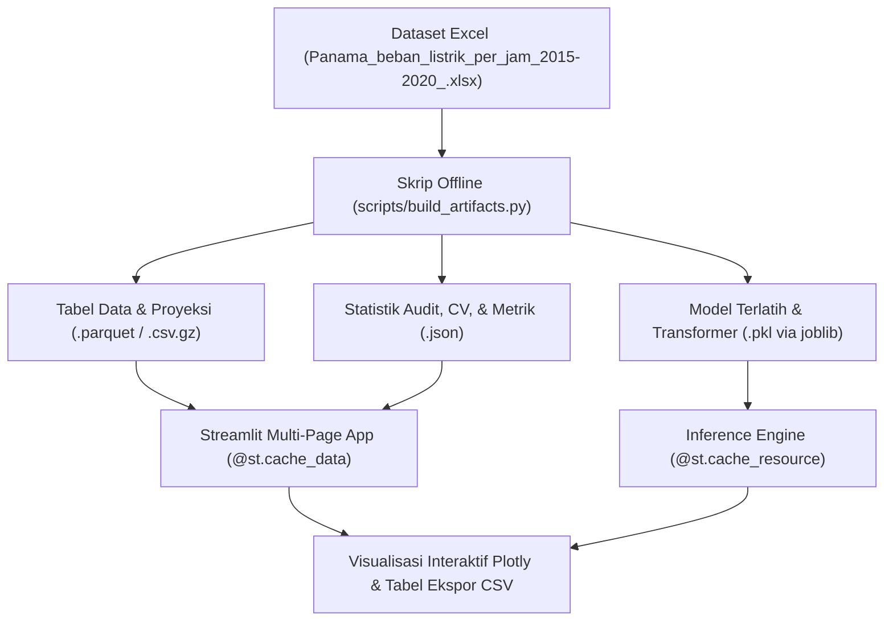

# Rancangan Arsitektur & Spesifikasi Dashboard Interaktif Streamlit: Analisis & Forecasting Beban Listrik Panama (2015–2020)

Dokumen ini merupakan rancangan lengkap (*blueprint*) pembangunan aplikasi web interaktif **Streamlit** berbasis hasil analisis pada notebook [Analisis_Beban_Listrik_Panama_2015-2020.ipynb](file:///c:/Users/user/Documents/S2/Semester%202/Analisis%20Data%20Lanjut/W12%20adl%201/Analisis_Beban_Listrik_Panama_2015-2020.ipynb) dan dataset [Panama_beban_listrik_per_jam_2015-2020_.xlsx](file:///c:/Users/user/Documents/S2/Semester%202/Analisis%20Data%20Lanjut/W12%20adl%201/Panama_beban_listrik_per_jam_2015-2020_.xlsx) (`48.048` observasi per jam, `17` kolom, rentang `2015-01-03 01:00` s.d. `2020-06-27 00:00` UTC−05:00).

---

## 1. Ringkasan Eksekutif & Persona Pengguna

Aplikasi dirancang sebagai **multi-page Streamlit dashboard** yang menyatukan eksplorasi deret waktu energi, audit diagnostik statistik, evaluasi model *backtesting*, analisis dampak kausal pandemi COVID-19, proyeksi masa depan jangka pendek & jangka panjang, serta simulator *what-if* waktu nyata (*real-time inference*).

| Persona Pengguna | Kebutuhan Utama | Modul Dashboard Prioritas |
| :--- | :--- | :--- |
| **1. Operator Jaringan & Perencana Operasi (CND Panama)** | Memantau beban puncak harian, proyeksi STLF `7` hari (`168` jam) beserta interval ketidakpastian `90%` (`Q05–Q95`) untuk cadangan putar (*spinning reserve*), serta mengidentifikasi anomali *blackout* (`< 600` MWh). | Halaman 0 (*Overview*), Halaman 1 (*Audit Data*), Halaman 4 (*Forecast 7 Hari*), Halaman 6 (*Simulator What-If*). |
| **2. Peneliti & Analis Kebijakan Energi** | Menguji bukti ketidakmemadaian `SARIMA`/`SARIMAX` vs keunggulan model solusi (`GAM` & `HistGradientBoosting`), membaca kurva respons suhu non-linear & `22` kategori `Holiday_ID`, memverifikasi dampak kausal murni lockdown `Mar–Jun 2020` (`-505,86` GWh), serta membandingkan skenario proyeksi `12` bulan (`9,762 – 11,315` TWh). | Halaman 0 (*Overview*), Halaman 2 (*Evaluasi 5 Model & CV*), Halaman 3 (*Cuaca, Libur, & Kausal COVID-19*), Halaman 5 (*Forecast 12 Bulan*). |

---

## 2. Arsitektur Sistem & Strategi Performa (*Pre-Computed Artifacts*)

### 2.1 Mengapa Menggunakan Arsitektur *Pre-Computed Artifacts*?
Membaca file Excel mentah berukuran `~8,57 MB` (`Panama_beban_listrik_per_jam_2015-2020_.xlsx`), lalu menjalankan *fitting* `SARIMA`/`SARIMAX` *rolling weekly* (`~73` detik), `TimeSeriesSplit` `3`-fold + `4` model `HistGradientBoosting` (`~70–180` detik), serta `GAM` + *refit* Tahap 8 membutuhkan total **3–5 menit** jika dijalankan ulang saat aplikasi dibuka.

Oleh karena itu, dashboard memisahkan fase **komputasi offline** dan **penyajian interaktif**:
1. Skrip `scripts/build_artifacts.py` dijalankan **satu kali** secara *offline* untuk mengekstrak seluruh tabel deret waktu, statistik diagnostik, metrik CV & *backtesting*, hasil proyeksi Tahap 8A & 8B, serta model terlatih (`GAM`, `HistGradientBoosting`, `PCA`, `StandardScaler`) ke folder `artifacts/`.
2. Aplikasi Streamlit memuat artefak terkompresi via `@st.cache_data` dan objek model via `@st.cache_resource`, sehingga waktu muat awal aplikasi turun menjadi **`< 2` detik** namun tetap mampu melakukan inferensi *what-if* langsung (*real-time*).



### 2.2 Struktur Direktori yang Direkomendasikan

```text
W12 adl 1/
├── Analisis_Beban_Listrik_Panama_2015-2020.ipynb
├── Panama_beban_listrik_per_jam_2015-2020_.xlsx
├── Plan_Analisis_Matematis_Beban_Listrik_Panama.md
├── Rancangan_Analisis_Beban_Listrik_Panama_2015-2020.md
├── Plan_Dashboard_Streamlit_Beban_Listrik_Panama.md
├── requirements.txt
├── .streamlit/
│   └── config.toml                 # Tema Obsidian Grid, tipografi, dan konfigurasi server
├── assets/
│   └── styles.css                  # Design system CSS kustom (Bento cards, tabular-nums, animasi, skeleton)
├── scripts/
│   └── build_artifacts.py          # Ekspor offline data, metrik, & model terlatih
├── artifacts/
│   ├── master_hourly.parquet       # Data historis + pred_naive/sarima/sarimax/gam/gbm + Q05/Q50/Q95
│   ├── forecast_st_168h.parquet    # Hasil proyeksi Tahap 8A (27 Jun - 4 Jul 2020)
│   ├── forecast_lt_12m.parquet     # Hasil proyeksi Tahap 8B (Jul 2020 - Jun 2021, 2 skenario)
│   ├── audit_stats.json            # ADF/KPSS, FFT peaks, VIF, BP/ARCH-LM, DM test, CV, Placebo, COVID GWh
│   ├── model_gam_pre.pkl           # res_gam_pre + gam_bounds_pre + gam_cols_pre
│   ├── model_gam_covid.pkl         # res_gam_covid + gam_bounds_cov + gam_cols_cov + cov_coef
│   ├── model_gbm_full.pkl          # model_st_pt, q05, q50, q95 + set_b_features
│   └── preprocessors.pkl           # scaler_t2m, pca_t2m, pca_t2m_sign, clim_mdh, holiday_map
├── utils/
│   ├── __init__.py
│   ├── data_loader.py              # Loader ter-cache (@st.cache_data & @st.cache_resource)
│   ├── ui_components.py            # Komponen HTML/CSS kustom (Command Bar, Bento KPI + sparkline, Alert Banner)
│   ├── charts.py                   # Factory grafik Plotly transparan, peta 3 kota Panama, & animasi
│   └── inference.py                # Pipeline fitur Set A / Set B untuk simulator & skenario kustom
├── app.py                          # Router st.navigation + Halaman 0: Executive Overview
└── pages/
    ├── 1_Eksplorasi_&_Audit_Statistik.py
    ├── 2_Evaluasi_Model_&_CV.py
    ├── 3_Sensitivitas_Cuaca_&_COVID19.py
    ├── 4_Forecast_Jangka_Pendek_7Hari.py
    ├── 5_Forecast_Jangka_Panjang_12Bulan.py
    └── 6_Simulator_WhatIf.py
```

---

## 3. Rancangan Detail 7 Halaman / Modul Interaktif

### Halaman 0 (`app.py`): *Executive Overview* & Peta Metodologi
- **Tujuan:** Memberikan ringkasan angka kunci dari seluruh penelitian sekaligus navigasi cepat ke 6 modul analitik dengan antarmuka bergaya *grid command console* (**Top Command Telemetry Bar** + **Bento Grid**).
- **Kontrol Interaktif:**
  - *Inline Contextual Ribbon* filter cepat rezim pada grafik timeline (`Semua 2015–2020`, `Training 2015–2018`, `Normal 2019`, `Disrupsi 2020`).
  - `st.expander` **"Peta Eksplisit: Train–Test Split, CV, & Kategori Forecast"** yang menampilkan alur metodologis tanpa *data leakage*.
- **Bento KPI Cards (`5` kartu kustom dengan *inline SVG sparkline* & animasi *count-up* saat muat awal):**
  1. **Total Observasi Historis:** `48.048` jam (`Mean 1.182,87` MWh + sparkline tren tahunan `2015–2020`).
  2. **Model STLF Terbaik (`2019` No Blackout):** `HistGradientBoosting` — RMSE `54,05` MWh \| MAPE `3,31%`.
  3. **Defisit Kausal COVID-19 (`Mar–Jun 2020`):** `-505,86` GWh (`-13,02%` rata-rata + delta pill crimson).
  4. **Proyeksi Jangka Pendek (`7` Hari):** `185,98` GWh (`Mean 1.107,01` MWh).
  5. **Proyeksi Jangka Panjang (`12` Bulan):** `9,762 – 11,315` TWh (rentang Skenario COVID vs Pemulihan Normal).
- **Visualisasi Plotly:**
  1. **Timeline Kronologis 3 Rezim (8 kolom):** Kurva rata-rata harian beban listrik (`2015–2020`) dengan arsiran warna blok `Training 2015–2018` (`72,88%`), `Test Normal 2019` (`18,23%`), `Test 2020` (`8,89%`, disorot zona lockdown `Mar–Jun 2020` = `5,90%`), serta penanda `8` titik *blackout*.
  2. **Peta Geografis 3 Stasiun Cuaca Panama (4 kolom):** Peta ringkas wilayah Panama menampilkan titik **Tocumen**, **Santiago**, dan **David** beserta korelasi suhu terhadap beban nasional (`r = 0,653`, `0,627`, `0,648`).
- **Tabel / Ekspor:** Tabel ringkasan `split_summary_df` yang menjelaskan rentang waktu, jumlah jam, proporsi, jumlah *blackout*, dan fungsi metodologis tiap blok.

---

### Halaman 1 (`1_Eksplorasi_&_Audit_Statistik.py`): Eksplorasi Data & Audit Statistik (Tahap 1)
- **Tujuan:** Memungkinkan pengguna menelusuri profil beban dan cuaca 3 kota secara interaktif, melihat sebaran spasial stasiun meteorologi Panama, serta memverifikasi 6 bukti statistik awal sebelum pemodelan.
- **Kontrol Interaktif (Ribbon Atas & Sidebar):**
  - `st.date_input` rentang tanggal historis (`2015-01-03` s.d. `2020-06-27`).
  - `st.selectbox` resolusi agregasi (`Per Jam`, `Rata-rata Harian`, `Rata-rata Mingguan`).
  - `st.selectbox` variabel cuaca sekunder (`T2M` Suhu, `QV2M` Kelembapan Spesifik, `TQL` Presipitasi, `W2M` Kecepatan Angin) dan pilihan kota (`Tocumen`, `Santiago`, `David`).
  - `st.toggle` tampilkan sorotan `Blackout (< 600 MWh)` dan zona `Lockdown Mar–Jun 2020`.
- **Bento KPI Cards:** Rata-rata beban periode terpilih, beban maksimum (`1.754,88` MWh global), beban minimum (`85,19` MWh saat *blackout*), dan selisih beban hari biasa vs hari libur (`1.191,12` vs `1.060,09` MWh / `-11,0%`).
- **Visualisasi Plotly:**
  1. **Dual-Axis Time-Series:** Sumbu kiri `nat_demand` (MWh), sumbu kanan variabel cuaca kota terpilih, lengkap dengan penanda `8` titik *blackout*.
  2. **Peta Interaktif 3 Stasiun Cuaca Panama (`scattergeo` / `scattermap`):** Memetakan koordinat riil **Tocumen (`9.07°N, 79.38°W`)**, **Santiago (`8.10°N, 80.98°W`)**, dan **David (`8.43°N, 82.43°W`)** dengan ukuran & warna penanda berdasarkan rata-rata `T2M`, korelasi `nat_demand`, atau nilai `VIF`.
  3. **Animasi Evolusi Profil Beban 24 Jam (`2015–2020`):** Grafik ber-`animation_frame="year_month"` (kontrol *Play / Pause* & *scrubber*) untuk mengamati pertumbuhan stabil kurva harian `2015–2019` lalu penurunan drastis & perataan puncak siang saat pandemi `Maret–Juni 2020`, disandingkan dengan **Heatmap Intraharian (`Jam 0–23` × `Senin–Minggu`)**.
  4. **Periodogram FFT Interaktif & ACF (`Lag 1–180`):** Memungkinkan zoom ke puncak frekuensi dominan $S_1 = 24$ jam (Power `483,95` juta), harmonik $12$ jam, dan $S_2 = 168$ jam (Power `51,69` juta).
  5. **Bar Chart Multikolinearitas Spasial (VIF):** Menyoroti `T2M_san` (`19,69`), `T2M_dav` (`14,78`), `T2M_toc` (`11,13`), dan `QV2M_san` (`10,82`) melewati garis ambang $\text{VIF} = 10$.
- **Tabel & Ekspor:**
  - Tabel uji stasioneritas **ADF & KPSS** (Level, First Diff, Seasonal Diff 24), uji heteroskedastisitas **Breusch-Pagan** & **ARCH-LM(24)**, serta tabel interaktif **8 Titik *Blackout*** (termasuk insiden `2019-01-20 12:00–16:00` yang turun hingga `85,19` MWh) + tombol unduh CSV.

---

### Halaman 2 (`2_Evaluasi_Model_&_CV.py`): Evaluasi Komparatif 5 Model, CV `TimeSeriesSplit`, & Diagnostik Ketidakmemadaian (Tahap 2, 4, 5, 7)
- **Tujuan:** Menyajikan evaluasi *backtesting* yang adil lintas seluruh 5 model (metode dasar vs model solusi), membuktikan stabilitas lewat `TimeSeriesSplit` 3-fold, dan menampilkan bukti empiris kegagalan `SARIMA`/`SARIMAX`.
- **Struktur 3 Tab Interaktif (`st.tabs`):**
  - **Tab A — Perbandingan Lengkap 5 Model & Uji *Diebold-Mariano*:**
    - *Kontrol:* `st.multiselect` pemilihan model (`Seasonal Naive`, `SARIMA`, `SARIMAX`, `GAM Set A`, `HistGradientBoosting Set B`), radio filter evaluasi `2019` (`Dengan Blackout` vs `Tanpa 5 Titik Blackout`), serta slider pemilihan minggu zoom sepanjang `2019–Jun 2020`.
    - *Visualisasi:* Grouped Bar Chart **RMSE & MAE (`2019`)**, Scatter/Bar **MAPE Normal (`2019`) vs MAPE Pandemi (`Mar–Jun 2020`)**, dan grafik **Zoom Mingguan Interaktif** (Aktual vs Prediksi model terpilih + pita interval 90% `Q05–Q95` milik `HistGradientBoosting`).
    - *Tabel:* `summary_df` lengkap dengan kolom `Kategori_Forecast`, `MAE`, `RMSE`, `MAPE`, `DM_vs_SARIMAX` (`+9,31` untuk Boosting, `+6,57` untuk GAM), dan `DM_vs_Naive` (`+6,44` untuk Boosting, `+3,19` untuk GAM).
  - **Tab B — Cross-Validation Temporal (`TimeSeriesSplit` 3-Fold pada `2015–2018`):**
    - *Visualisasi:* **Animasi *Walk-Forward* `TimeSeriesSplit`** (tombol *Play* transisi Fold 1 → Fold 2 → Fold 3 yang memperlihatkan blok latih meluas vs tahun validasi `2016 → 2017 → 2018`) dan perbandingan skor RMSE/MAE per fold antara **`GAM`** (rata-rata CV RMSE `78,23` MWh, MAPE `5,33%`) vs **`HistGradientBoosting`** (rata-rata CV RMSE `47,75` MWh, MAPE `3,11%`).
    - *Tabel:* `cv_gam_df` dan `cv_gbm_df` (Fold, Periode Latih, Periode Validasi, `N_Train`, `N_Val`, MAE, RMSE, MAPE).
  - **Tab C — Audit Ketidakmemadaian `SARIMA` & `SARIMAX`:**
    - *Visualisasi:* (1) Plot **ACF Error Uji 2019** (`Lag 1–174`) memperlihatkan kebocoran lonjakan di **Lag `168`** pada `SARIMAX` dibanding `GAM` dan `HistGradientBoosting`; (2) Plot **Over-Forecast Lockdown April 2020** (`1–21 Apr 2020`); (3) **Error Breakdown `SARIMAX`** pada hari biasa (`MAPE 6,29%`) vs hari libur (`MAPE 10,68%`) dan RMSE per jam (`0–23`).
    - *Tabel:* Statistik uji **Ljung-Box** (lag 24 & 168), **Jarque-Bera**, dan **ARCH-LM** ($p \approx 0$).

---

### Halaman 3 (`3_Sensitivitas_Cuaca_&_COVID19.py`): Sensitivitas Cuaca, Efek Hari Libur, & Dampak Kausal COVID-19 (Tahap 4 & 5 XAI)
- **Tujuan:** Menjawab pertanyaan ilmiah mengenai pendorong non-linear konsumsi listrik Panama dan memisahkan efek cuaca/kalender dari dampak murni pembatasan COVID-19.
- **Kontrol Interaktif:**
  - `st.multiselect` bulan analisis COVID-19 (`Maret`, `April`, `Mei`, `Juni 2020`, serta pembanding kontrol `Januari–Februari 2020`).
  - `st.radio` tipe hari untuk profil intraharian (`Hari Kerja` vs `Akhir Pekan`).
  - `st.slider` jumlah kategori teratas `Holiday_ID` (`1–22`) yang ditampilkan.
- **Bento KPI Cards:**
  - **Validitas *Placebo Test* (`Mar–Jun 2019`):** Bias rata-rata `+6,35` MWh (`+0,66%`, MAE `61,89` MWh).
  - **Total Energi Hilang (`Mar–Jun 2020`):** **`-505,86` GWh** (rata-rata `-178,56` MWh/jam atau `-13,02%`), puncak penurunan pada **April 2020** (`-235,46` MWh/jam / `-16,98%` / `-169,53` GWh).
- **Visualisasi Plotly:**
  1. **Kurva *Counterfactual* GAM (`Jan–Jun 2020`):** Aktual harian vs prediksi *counterfactual* $\hat{Y}_t(0)$ beserta pita `95% CI` dan arsiran merah defisit beban mulai `1 Maret 2020`.
  2. **Animasi Transisi Profil Intraharian 24 Jam (`Jan–Jun 2020`):** Memperlihatkan animasi pergeseran kurva `Aktual` vs `Counterfactual` per jam (`0–23`) dari bulan kontrol normal (`Jan–Feb`) menuju kejut lockdown (`Apr`) dan pemulihan parsial (`Jun`), dengan filter Hari Kerja vs Akhir Pekan.
  3. **Sensitivitas Suhu Non-Linear (`GAM` vs `Boosting PDP`):** Panel berdampingan antara kurva spline `T2M_pca1` (+ `95% CI`) pada GAM dan *Partial Dependence Plot* `T2M_toc` pada `HistGradientBoosting`.
  4. **Efek Spesifik `22` Kategori `Holiday_ID` & *Grouped Feature Importance*:** Bar chart horizontal koefisien penurunan beban tiap hari libur + ranking kontribusi kelompok fitur (`Lag Beban Historis`, `Cuaca 3 Kota`, `Kalender`, `Waktu Siklikal & Tren`).
- **Tabel & Ekspor:** Tabel `monthly_cf` (`Jan–Jun 2020`) + tombol unduh CSV deret *counterfactual* per jam.

---

### Halaman 4 (`4_Forecast_Jangka_Pendek_7Hari.py`): Forecasting Jangka Pendek 7 Hari / 168 Jam (`27 Jun – 4 Jul 2020`, Tahap 8A)
- **Tujuan:** Menyajikan hasil peramalan operasional **7 hari (`168` jam) ke depan** di luar akhir dataset menggunakan `HistGradientBoosting` Set B (refit penuh `47.544` jam valid) secara interaktif bagi operator jaringan.
- **Kontrol Interaktif:**
  - `st.number_input` atau `st.slider` **Ambang Batas Peringatan Beban / Kapasitas Pembangkit** (default `1.250` MWh) yang memicu **Dynamic Peak-Alert Banner** serta menyorot jam-jam kritis melebihi kapasitas aman (*spinning reserve alert*).
  - `st.checkbox` tampilkan pita **Interval Prediksi 90% (`Q05–Q95`)** dan kurva median `Q50`.
  - `st.selectbox` filter tampilan tanggal spesifik (`Semua 7 Hari` atau per tanggal `2020-06-27` s.d. `2020-07-04`).
- **Bento KPI Cards & Dynamic Alert Banner:**
  - **Rata-rata Beban Prediksi:** `1.107,01` MWh
  - **Rentang Minimum – Puncak:** `911,11` s.d. `1.306,46` MWh
  - **Total Energi 7 Hari:** `185,98` GWh
  - **Lebar Rata-rata PI 90%:** `137,47` MWh
  - **Banner Peringatan Dinamis:** Otomatis menampilkan jumlah jam di atas ambang operator (mis. saat puncak `1.306,46` MWh melewati `1.250` MWh) dengan aksen amber/crimson halus.
- **Visualisasi Plotly:**
  1. **Kurva Kontinu Aktual ke Proyeksi 168 Jam:** Menampilkan `7` hari aktual terakhir (`20–27 Jun 2020`) bersambung mulus dengan proyeksi `168` jam (`27 Jun – 4 Jul 2020`), pita `Q05–Q95`, garis vertikal batas akhir dataset, dan garis horizontal ambang kapasitas operator.
  2. **Profil Rata-rata vs Puncak Harian:** Grouped bar chart per tanggal (`Sabtu 27 Jun` s.d. `Sabtu 4 Jul 2020`).
- **Tabel & Ekspor:**
  - `st.expander` **"Asumsi Klimatologi & Fitur Lag Non-Rekursif"** (cuaca klimatologi `2015–2019`, lag beban `100%` dari observasi historis, kalender `holiday=0, school=1`).
  - Tabel ringkasan harian (`st_daily_df`) dan tabel penuh `168` jam (`pred_st_mean`, `pred_st_q05`, `pred_st_q50`, `pred_st_q95`, `pi_width_90`) + tombol `st.download_button` ekspor CSV.

---

### Halaman 5 (`5_Forecast_Jangka_Panjang_12Bulan.py`): Forecasting Jangka Panjang 12 Bulan (`Jul 2020 – Jun 2021`, Tahap 8B)
- **Tujuan:** Membandingkan proyeksi jangka panjang `12` bulan penuh (`8.760` jam) dengan `GAM` Set A pada skenario pemulihan normal vs tekanan COVID-19 berkelanjutan, lengkap dengan simulasi pemulihan bertahap dengan transisi kurva mulus.
- **Kontrol Interaktif:**
  - `st.multiselect` / `st.checkbox` tampilan skenario:
    - **Skenario A — Pemulihan Normal Pra-COVID:** `Mean 1.291,65` MWh \| Peak `1.617,27` MWh \| Total `11.314,86` GWh (`11,315` TWh).
    - **Skenario B — Tekanan Pandemi Berkelanjutan:** `Mean 1.114,34` MWh \| Peak `1.438,98` MWh \| Total `9.761,60` GWh (`9,762` TWh) dengan koefisien rezim `-177,44` MWh (`-13,73%` vs Skenario A).
  - **Kontrol Skenario Kustom (dengan *Smooth Plotly Curve Transition* `uirevision` + `transition`):**
    - `st.slider` **Tingkat Pemulihan Ekonomi/Mobilitas** (`0%` = tetap rezim COVID-19 penuh s.d. `100%` = pulih normal penuh; atau kurva transisi linear kuartalan).
    - `st.slider` **Anomali Suhu Regional ($\Delta T2M$)** dari `-2,0°C` hingga `+3,0°C` yang memanggil `model_gam_pre` / `model_gam_covid` ter-cache untuk menghitung ulang sensitivitas beban jangka panjang akibat anomali iklim (mis. El Niño) tanpa mengedipkan ulang viewport grafik.
- **Bento KPI Cards:** Total energi tahunan Skenario A (`11,315` TWh), Total energi tahunan Skenario B (`9,762` TWh), Selisih antar-skenario (`-1.553,26` GWh / `-13,73%`), dan Referensi Aktual `2019` (`10.893,77` GWh / `10,894` TWh).
- **Visualisasi Plotly:**
  1. **Lintasan Historis Bulanan (`2015–Jun 2020`) + Proyeksi 12 Bulan (`Jul 2020–Jun 2021`):** Lengkap dengan `95% CI` Skenario A, Skenario B, dan garis Skenario Kustom pengguna dengan transisi animasi halus (`450ms`).
  2. **Perbandingan Energi Bulanan (GWh):** Grouped bar chart tiap bulan (`2020-07` s.d. `2021-06`) melawan referensi bulan yang sama pada tahun `2019`.
- **Tabel & Ekspor:** Tabel bulanan (`lt_monthly_display`) + tombol unduh CSV hasil proyeksi `12` bulan.

---

### Halaman 6 (`6_Simulator_WhatIf.py`): Simulator *What-If* Beban Listrik (*Real-Time Inference*)
- **Tujuan:** Memberikan laboratorium interaktif bagi pengguna untuk menguji bagaimana perubahan kondisi cuaca, kalender hari libur, dan status rezim pandemi memengaruhi prediksi beban per jam dan kurva `24` jam.
- **Kontrol Input Pengguna:**
  - `st.radio` pilihan model inferensi: **`GAM (Set A Eksogen)`** (cocok untuk uji sensitivitas murni cuaca/libur/rezim COVID) atau **`HistGradientBoosting (Set B)`** (memakai referensi *lag* mingguan dari minggu normal/pandemi terpilih + interval `Q05–Q95`).
  - Input kalender: Tanggal acuan (atau Bulan + Hari dalam Minggu), Jam fokus (`0–23`), `Holiday_ID (0–22)` dengan label deskriptif, status `school` (`0/1`), serta toggle **Rezim COVID-19 (`Aktif / Tidak Aktif`)**.
  - Input cuaca: Slider `T2M_toc`, `T2M_san`, `T2M_dav` (°C), `QV2M_toc`, serta opsi *"Sinkronkan Suhu 3 Kota secara Proporsional"* agar tetap realistis terhadap korelasi spasial dataset.
- **Output & Visualisasi:**
  1. **Metric Card Prediksi Jam Terpilih:** Nilai prediksi (MWh), `95% CI` (GAM) atau `90% PI` (Boosting), serta delta terhadap rata-rata beban jam yang sama pada hari kerja normal `2019`.
  2. **Kurva Simulasi Profil 24 Jam Penuh (`00:00–23:00`):** Menampilkan bentuk kurva beban sepanjang hari untuk kombinasi skenario input pengguna vs profil baseline hari biasa.

---

## 4. Rancangan Desain Visual, UX, & Arsitektur Visualisasi Hibrida

### 4.1 Konsep Estetika & Prinsip *Clean SaaS Modern (`streamlit-shadcn-ui`)*
Dashboard mengadopsi tampilan **Clean SaaS Modern** berbasis pustaka komponen asli **`streamlit-shadcn-ui`** (terinspirasi dari *Shadcn/ui*, *Ember Electricity Explorer*, dan *Evidence.dev*). Desain menghindari hiasan berlebihan yang identik dengan antarmuka buatan AI (seperti *command bar* dengan titik berdenyut, *badge pill* warna-warni, garis samping KPI warna pelangi, mini sparkline, dan bingkai kotak di sekitar setiap elemen).

| Aspek UI/UX | Pola Berlebihan (Dihindari) | Standar Clean SaaS (Diterapkan) |
| :--- | :--- | :--- |
| **Permukaan & Warna** | Tema neon atau kartu penuh warna pelangi. | Latar putih bersih (`#FFFFFF`), sidebar lembut (`#F8FAFC`), border halus (`#E2E8F0`), dan palet terkendali (**Slate `#0F172A`**, **1 aksen biru `#2563EB`**, **emerald `#059669`**, serta **merah `#DC2626`** hanya untuk alert/anomali). |
| **Kartu Metrik & Tab** | HTML/CSS kartu kustom dengan garis warna, sparkline, dan animasi *fade-in*. | Komponen presisi **`ui.metric_card`**, **`ui.tabs`**, dan **`ui.alert`** dari `streamlit-shadcn-ui` tanpa dekorasi berlebihan. |
| **Header & Navigasi** | Header *telemetry bar* dengan *pulse dot*, *badge*, dan label `TAHAP X · ...`. | Judul halaman ringkas (`st.markdown` `h1`) + 1 baris subjudul deskriptif + navigasi sidebar `st.navigation` dengan label natural. |
| **Pemilihan Mesin Grafik** | Memaksakan seluruh grafik memakai Plotly. | **Arsitektur Hibrida Matplotlib + Plotly:** `Matplotlib` (*despined*, DPI 135) untuk plot statistik, ACF *stem*, CV, *counterfactual*, & perbandingan batang; `Plotly` khusus deret waktu yang butuh zoom/hover & peta 3 kota Panama. |

---

### 4.2 Konfigurasi Tema (`.streamlit/config.toml`)
```toml
[theme]
base = "light"
primaryColor = "#2563EB"
backgroundColor = "#FFFFFF"
secondaryBackgroundColor = "#F8FAFC"
textColor = "#0F172A"
font = "sans serif"

[client]
toolbarMode = "minimal"
showSidebarNavigation = true
```

---

### 4.3 Pembagian Peran Mesin Visualisasi (`utils/charts.py`)
- **Matplotlib (`st.pyplot`, DPI 135, *despined*):** Evaluasi profil `24` jam lintas tahun & heatmap (Hal 1), FFT & *stem* ACF (Hal 1), VIF (Hal 1), perbandingan RMSE/MAE `5` model & ACF error (Hal 2), skema & skor CV `3`-fold (Hal 2), 3 panel ketidakmemadaian `SARIMA`/`SARIMAX` (Hal 2), *counterfactual* harian & pergeseran profil `24` jam COVID-19 (Hal 3), panel `2×2` suhu/`hour`/`Holiday_ID`/PDP & XAI *importance* (Hal 3), bar harian `7` hari (Hal 4), bar energi `12` bulan GWh (Hal 5), serta grafik deviasi $\Delta$ MWh & suhu `3` kota (Hal 6).
- **Plotly Clean Light (`st.plotly_chart`, `theme=None`):** Linimasa `3` rezim & peta `3` stasiun cuaca Panama (Hal 0–1), *dual-axis explorer* (Hal 1), *zoom* mingguan overlay model (Hal 2), kurva proyeksi `168` jam (Hal 4), proyeksi `12` bulan `uirevision` (Hal 5), dan kurva interaktif `24` jam Simulator *What-If* (Hal 6).

---

## 5. Spesifikasi Lingkungan, Dependensi, & Strategi Caching

### 5.1 Audit Lingkungan Saat Ini & Catatan Kompatibilitas Python
Berdasarkan pemeriksaan lingkungan lokal saat rancangan ini disusun (`Python 3.15.0`):
- **Sudah Terpasang:** `pandas`, `numpy`, `scipy`, `scikit-learn`, `statsmodels`, `joblib`, `openpyxl`, `matplotlib`.
- **Belum Terpasang:** `streamlit`, `plotly`, `pyarrow`, `lightgbm`, `shap`.

> [!WARNING]
> **Catatan Kompatibilitas Python `3.15` vs `3.11 / 3.12`:**
> Beberapa pustaka inti dashboard (`streamlit`, `pyarrow`, atau `lightgbm`/`shap`) sering kali belum menyediakan *pre-built binary wheel* untuk rilis Python terbaru (`3.15.0`) di Windows. Jika `pip install streamlit plotly pyarrow` gagal melakukan kompilasi lokal, buat *virtual environment* khusus **Python `3.11` atau `3.12`** untuk menjalankan dashboard (`py -3.12 -m venv .venv_st`).
> Sebagai mitigasi tambahan di kode, `build_artifacts.py` dan `utils/data_loader.py` sebaiknya mendukung **fallback otomatis** `.parquet` → `.csv.gz` (atau `.pkl`) apabila `pyarrow` tidak terpasang.

### 5.2 Daftar Paket (`requirements.txt`)
Navigasi antar-halaman memakai **`st.navigation` bawaan Streamlit (`1.67.0`)** dan komponen KPI, tabs, serta alert memakai pustaka **`streamlit-shadcn-ui`** (`1.5.0`) agar konsisten bergaya Clean SaaS Modern tanpa *wrapper* HTML kustom yang rapuh. Seluruh versi paket dipin agar proses deserialisasi `.pkl` di *cloud* tetap identik (*membutuhkan Python `>=3.12`*).

```text
streamlit==1.67.0
streamlit-shadcn-ui==1.5.0
plotly==7.1.0
matplotlib==3.11.2
pandas==3.0.6
numpy==2.5.4
scipy==1.18.1
scikit-learn==1.9.1
statsmodels==0.15.0
joblib==1.6.0
openpyxl==3.1.5
pyarrow==26.0.1
# Opsional (otomatis fallback ke HistGradientBoosting + Permutation Importance jika tidak terpasang):
# lightgbm>=4.3.0
# shap>=0.45.0
```

### 5.3 Kebijakan Caching & Target Performa
| Fungsi | Dekorator | Objek yang Di-cache | Target Latensi |
| :--- | :--- | :--- | :--- |
| `load_hourly_data()`, `load_forecasts()`, `load_audit_json()` | `@st.cache_data` | DataFrame teragregasi/tabel & JSON metrik | `< 300` ms |
| `load_models()`, `load_preprocessors()` | `@st.cache_resource` | Model `GLMGam`, `HistGradientBoosting`, `PCA`, `StandardScaler` | `< 500` ms (sekali per sesi server) |
| Inferensi *what-if* & skenario kustom 12 bulan | — (komputasi vektor NumPy/Pandas) | Prediksi 24 jam (Halaman 6) & 8.760 jam GAM (Halaman 5) | `< 400` ms per interaksi slider |

---

## 6. Roadmap Implementasi & Checklist Verifikasi

### 6.1 Urutan Pembangunan (4 Fase)
1. **Fase 1 — Fondasi Data, Artefak Offline, & Design System:**
   - Buat `.streamlit/config.toml` (*Clean SaaS Light* `#FFFFFF` / `#F8FAFC` / `#2563EB`), `assets/styles.css` (tipografi `Inter`, `tabular-nums`, tata letak datar bebas *chrome*), dan `requirements.txt`.
   - Implementasikan `scripts/build_artifacts.py` yang mereplikasi logika bersih notebook `Analisis_Beban_Listrik_Panama_2015-2020.ipynb` dan mengekspor seluruh artefak ke `artifacts/`.
   - Implementasikan `utils/data_loader.py`, `utils/ui_components.py` (*wrapper* `streamlit-shadcn-ui` untuk `metric_card`, `tabs`, `alert`, serta *header* halaman bersih), dan `utils/charts.py` (*Hybrid* Matplotlib *despined* DPI `135` + Plotly `theme=None` latar putih + Peta `3` stasiun Panama).
2. **Fase 2 — Aplikasi Inti & Modul Audit/Evaluasi:**
   - Bangun `app.py` (`st.navigation` dengan judul ringkas berbahasa Indonesia) dan `pages/0_Executive_Overview.py` (peta `3` kota & linimasa `3` rezim), `pages/1_Eksplorasi_&_Audit_Statistik.py` (profil `24` jam lintas tahun, FFT, ACF, VIF, & *dual-axis explorer*), serta `pages/2_Evaluasi_Model_&_CV.py` (`ui.tabs` untuk Benchmark `5` Model, `TimeSeriesSplit` CV, & Ketidakmemadaian `SARIMA`/`SARIMAX`).
3. **Fase 3 — Modul Kausal & Forecasting Masa Depan:**
   - Bangun `pages/3_Sensitivitas_Cuaca_&_COVID19.py` (panel `2×2`, PDP & XAI, serta *counterfactual* harian + pergeseran profil `24` jam COVID-19), `pages/4_Forecast_Jangka_Pendek_7Hari.py` (`ui.alert` untuk jam puncak & proyeksi `168` jam), dan `pages/5_Forecast_Jangka_Panjang_12Bulan.py` (proyeksi `12` bulan *Normal vs COVID-19* + sensitivitas pemulihan).
4. **Fase 4 — Simulator Interaktif & Uji End-to-End:**
   - Implementasikan `utils/inference.py` dan `pages/6_Simulator_WhatIf.py`.
   - Uji seluruh halaman via `AppTest`, kontrol interaktif, ekspor CSV, konsistensi metrik, dan kesiapan server HTTP.

### 6.2 Checklist Verifikasi Konsistensi Angka & QA Desain/UX

#### A. Konsistensi Angka (Dashboard vs Notebook)
Sebelum dinyatakan selesai, pastikan seluruh angka yang tampil di Streamlit **identik** dengan hasil eksekusi notebook:
- [ ] **Split Data:** Train `35.015` jam (`72,88%`), Test `2019` `8.760` jam (`18,23%`), Test `2020` `4.273` jam (`8,89%`), Lockdown `2.833` jam (`5,90%`).
- [ ] **Evaluasi `2019` (No Blackout):** `Seasonal Naive` RMSE `97,94` \| `SARIMA` `120,38` \| `SARIMAX` `116,75` \| `GAM` `80,72` \| `HistGradientBoosting` `54,05` MWh (MAPE `3,31%`, `DM_vs_SARIMAX = +9,31`).
- [ ] **Cross-Validation (`TimeSeriesSplit` 3-Fold):** `GAM` rata-rata RMSE `78,23` MWh (`5,33%`), `HistGradientBoosting` rata-rata RMSE `47,75` MWh (`3,11%`).
- [ ] **Dampak Kausal COVID-19:** Placebo `Mar–Jun 2019` `+6,35` MWh (`+0,66%`); Defisit `Mar–Jun 2020` `-505,86` GWh (`-178,56` MWh/jam atau `-13,02%`).
- [ ] **Proyeksi Tahap 8A (`7` Hari / `168` Jam):** Rata-rata `1.107,01` MWh, puncak `1.306,46` MWh, total `185,98` GWh, lebar PI 90% `137,47` MWh.
- [ ] **Proyeksi Tahap 8B (`12` Bulan / `8.760` Jam):** Skenario Normal `11.314,86` GWh (`11,315` TWh) vs Skenario COVID-19 `9.761,60` GWh (`9,762` TWh), selisih `-1.553,26` GWh (`-13,73%`).
- [ ] **Uji Interaktivitas:** Tidak ada error saat mengganti filter tanggal, minggu zoom, tab evaluasi, bulan COVID-19, slider pemulihan/suhu, tombol download CSV, maupun simulator *what-if*.

#### B. Checklist QA Desain & UX (Clean SaaS Modern)
- [ ] **Bebas Artefak Visual "AI-Generated":** Tidak ada *telemetry command bar*, titik status berkedip, *pill badge*, *monospaced uppercase kicker*, garis aksen kiri berwarna pada kartu, SVG *sparkline*, maupun animasi CSS artifisial.
- [ ] **Tipografi & Alignment:** Seluruh angka KPI, tabel, dan sumbu grafik sejajar bersih menggunakan font `Inter` + `tabular-nums`.
- [ ] **Responsivitas Tata Letak:** Tidak ada *horizontal overflow* atau pemotongan label grafik pada resolusi `1366×768` maupun `1920×1080`.
- [ ] **Kontras & Keselarasan Kanvas:** Komponen `streamlit-shadcn-ui`, kanvas putih Plotly (`theme=None`), dan figur Matplotlib menyatu bersih di atas latar `#FFFFFF` / `#F8FAFC` dengan palet *monochrome slate* + aksen `#2563EB` / `#059669` / `#DC2626`.
